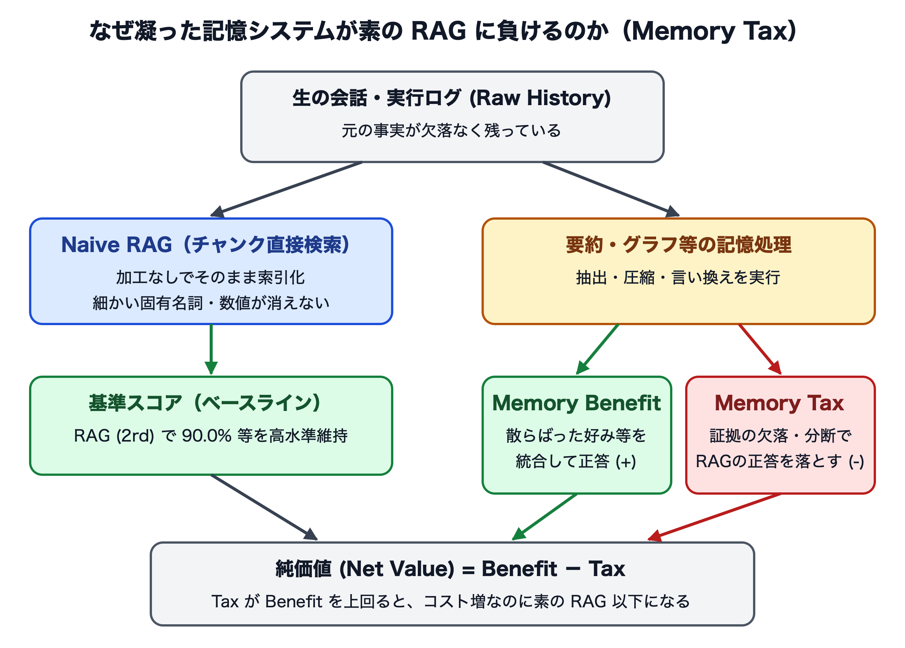
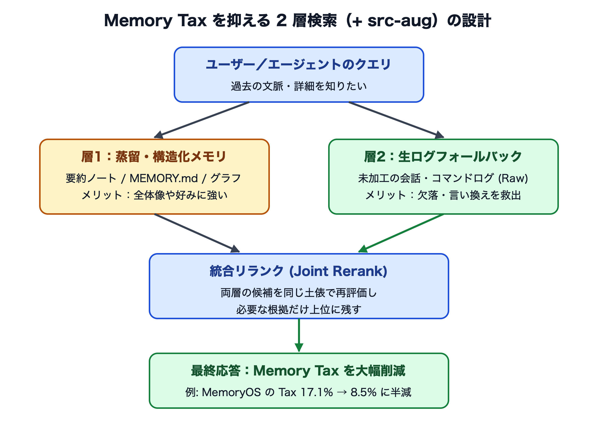

「AIエージェントに長期記憶を持たせようと、会話の要約パイプラインやグラフ型メモリを作り込んだのに、なぜか細かい過去の事実を忘れる。しかもトークンコストだけ跳ね上がった」

Claude Code の `MEMORY.md` や自律エージェントのメモリ層を設計していると、一度はこの違和感にぶつかります。良かれと思って「記憶を整理・圧縮」しているのに、素朴な全文検索や単純な RAG より精度が落ちるケースが少なくありません。

本記事を読むと、この現象の正体である **Memory Tax（記憶税）** がなぜ起きるのかを理解し、手元のエージェントや `MEMORY.md` 運用に **「要約メモリと生ログを両方検索する」2層検索** を取り入れて精度とコストを改善できるようになります。

:::message
**この記事の結論（tl;dr;）**
- 論文 *Memory Tax: Dissecting the Net Value of Agent Memory*（arXiv:2610.34073）の実証実験では、11種類の専用メモリシステムの多くが **素朴な RAG（Naive RAG）に精度で負ける** ことが示されました。
- 要約や構造化は、散らばった事実を統合する **Memory Benefit** を生む一方、証拠の欠落や言い換えによる **Memory Tax（記憶税）** を同時に発生させます。
- 対策は「凝ったメモリを捨てる」ことではなく、**生ログ（Raw History）へのフォールバック検索を並列で残し、統合リランクする（`+ src-aug`）** ことです。これだけで記憶税が約半分に減ります。
:::

## なぜ「凝った記憶システム」が素の RAG に負けるのか

UIUC や清華大学などの研究チームが 2026 年 10 月に発表した論文 *Memory Tax: Dissecting the Net Value of Agent Memory*（Xuan He ら、arXiv:2610.34073）は、これまで暗黙に信じられてきた「長期記憶システムを作ればエージェントは賢くなる」という前提に正面から疑問を投げかけました。

研究チームは、フラット型（A-Mem、MemOS、SimpleMem）、階層・ライフサイクル型（MemoryOS、LightMem、OpenViking）、グラフ型（HippoRAG2、MAGMA、PlugMem）、学習ポリシー型（Mem-T、Memory-R2）の計 11 システムを、LongMemEval-s・PersonaMem-v2・MINT-Eval の 3 つのベンチマークで比較しました。比較対象は、生の会話ログをそのままチャンク分割して検索する **Naive RAG** です。

結果は意外なものでした。たとえば GPT-5.6 Luna（low）をバックボーンにした LongMemEval-s では、2 ラウンドの Naive RAG が **90.0%** の正答率を出したのに対し、多くの専用メモリシステムがそれを大きく下回りました。

| 手法カテゴリ | 代表システム | LongMemEval-s 正答率（GPT-5.6 Luna） | RAG（2ラウンド）との差 |
| :--- | :--- | :--- | :--- |
| 比較基準 | Naive RAG（2ラウンド） | **90.0%** | — |
| フラット型 | A-Mem / MemOS | 84.0% / 78.0% | -6.0% / -12.0% |
| 階層型 | LightMem / OpenViking | 77.0% / 63.0% | -13.0% / -27.0% |
| グラフ型 | HippoRAG2 / MAGMA | 81.0% / 76.0% | -9.0% / -14.0% |

さらに問題なのは、これらの専用システムが記憶の構築・更新のために **Naive RAG よりはるかに多くのトークンと実行時間を消費している** 点です。「高いお金を払って、素の RAG より低い精度を買っている」状態が、多くの環境で起きています。



## Memory Tax（記憶税）を生む 3 つの原因

なぜ記憶を整理すると精度が落ちるのでしょうか。論文では、生の履歴から記憶を作る過程で生じる「変化」を両刃の剣として捉えています。

- **Memory Benefit**（記憶の恩恵）: 散らばった事実の統合やユーザーの好み・傾向の抽出によって、素の RAG では解けなかった質問に答えられるようになるプラス効果。実際、PersonaMem-v2（Qwen3.5-4B）では MemoryOS が **37.0%**（Naive RAG 比 +0.9pt）、LightMem が **36.4%**（+0.2pt）と素の RAG を上回り、複数発話に散らばった家族の年齢平均の計算（PlugMem）や「3週間前」といった相対日時の特定（SimpleMem）でも専用メモリが優位に立つケースが報告されています。
- **Memory Tax**（記憶税）: 記憶を作る過程で元の証拠が失われたり探しにくくなったりして、素の RAG なら解けたはずの質問を落とすマイナス効果。

実際の開発現場に置き換えると、Memory Tax は次の 3 つの形で現れます。

### 1. 忠実性の損失（Faithfulness Loss）：要約で「一番大事な細部」が消える

エージェントの会話ログを「今日は Docker ビルドのキャッシュ問題を解決した」と 1 行に要約したとします。人間には読みやすいですが、来週「あのとき効いたビルドフラグは何だっけ？」と聞かれたとき、肝心の `--no-cache` やエラーコードは要約から削ぎ落とされています。

論文のミクロ分析でも、事実単位の追跡で OpenViking は **38.0%** の事実がメモリユニットから完全に消失し、SimpleMem でも **27.6%** で部分的な情報欠落が確認されています。一度構築時に捨てられた細部は、検索時にどれだけ工夫しても二度と復元できません。

### 2. アクセス性の損失（Accessibility Loss）：言い換えと分断でヒットしなくなる

情報は残っていても、検索クエリと噛み合わなくなるケースです。

たとえばユーザーが元の会話で「Mac の Chrome で WebGL が重い」と言っていたのに、メモリ構築時に「ブラウザの描画パフォーマンスに関する課題」と言い換えて保存すると、後から `WebGL` や `Chrome` で検索したときのベクトル類似度やキーワード一致率が大きく下がります。また、1 つの文脈が複数のメモリ断片に分断されたり、無関係な要約と混ぜられたりすることでも検索順位が落ちます。

### 3. モデル変更への脆弱性（Robustness Loss）：バックボーン依存が増す

長寿命のエージェントでは「記憶を書いたモデル」と「後から記憶を読んで回答するモデル」が世代交代で変わることがあります。論文のクロスバックボーン検証（Qwen3.5-4B / Qwen3.6-27B / GPT-5.6 Luna 間の組み合わせ）でも、多くの専用メモリシステムではモデルを切り替えた際のスコア変動幅が Naive RAG より大きくなる傾向が報告されています。モデル固有の要約のクセに依存するほど、システム全体が壊れやすくなります。

## 解決策：Memory Tax を半減させる「2層検索（+ src-aug）」の設計

では、要約や `MEMORY.md` のような記憶整理はやめて、すべて生ログの RAG に戻すべきなのでしょうか。答えは **No** です。好みの統合や長期的な方針の把握など、Memory Benefit が効く場面は確実に存在します。

論文のセクション 6 で提案されている最も実用的でシンプルな解決策が、**生ログへのフォールバック経路を残す（`+ src-aug`）** アプローチです。



仕組みは非常に明快です。

1. **層 1**（蒸留・構造化メモリ）: 要約ノート、`MEMORY.md`、グラフなど「整理された記憶」を検索する。
2. **層 2**（生ログフォールバック）: 同じクエリで、未加工の会話履歴・実行ログ（Raw History）も並列でチャンク検索する。
3. **統合リランク**（Joint Rerank）: 両方の候補を 1 つのプールにまとめ、リランカー（または LLM の文脈長予算内での優先順位付け）で上位 $k$ 件に絞り込んでから回答を生成する。

たったこれだけの追加で、新しい記憶アーキテクチャを作り直すことなく、既存システムの Memory Tax を約半分まで抑えられます。論文の実験（Qwen3.6-27B）では、次のような改善が確認されています。

| システム | 通常時の正答率（Tax） | `+ src-aug` 適用後の正答率（Tax） |
| :--- | :--- | :--- |
| SimpleMem（LongMemEval-s） | 73.6%（Tax 12.0%） | **82.8%（Tax 5.2%）** |
| MemoryOS（PersonaMem-v2） | 48.2%（Tax 17.1%） | **53.0%（Tax 8.5%）** |
| Mem-T（PersonaMem-v2） | 42.1%（Tax 15.2%） | **49.0%（Tax 8.7%）** |

## Python で組む最小の 2 層検索（`+ src-aug`）実装

手元のエージェントにこの 2 層検索を組み込む最小イメージを示します（以下は設計パターンを示す未検証の擬似コードであり、そのまま実行できるものではありません）。既存のベクトルストアや `MEMORY.md` 検索を消す必要はなく、後ろに生ログ検索とクロスエンコーダ等による統合リランクを足すだけです。

```python:two_tier_memory.py
from dataclasses import dataclass

@dataclass
class MemoryUnit:
    source: str  # "distilled" or "raw"
    text: str
    score: float  # 各ストア固有のスコア（ストア間比較には使わずリランクに渡す）

def retrieve_with_source_fallback(
    query: str,
    distilled_store,
    raw_log_store,
    reranker,
    top_k: int = 6,
) -> list[MemoryUnit]:
    # 1. 整理済みメモリ（全体像・方針）と生ログ（固有名詞・細部）を並列検索
    distilled_hits = distilled_store.search(query, limit=top_k)
    raw_hits = raw_log_store.search(query, limit=top_k)

    # 2. 両者を統合し、テキストの重複を除いて候補プールを作る
    seen: set[str] = set()
    candidates: list[MemoryUnit] = []
    for source, hits in (("distilled", distilled_hits), ("raw", raw_hits)):
        for h in hits:
            key = h.text.strip()
            if key in seen:
                continue
            seen.add(key)
            candidates.append(MemoryUnit(source, h.text, h.score))

    # 3. 異なるストア間のスコアは比較不能なため、リランカーで「今最も直接的な根拠」を上位に残す
    reranked = reranker.rank(query=query, documents=candidates)
    return reranked[:top_k]
```

:::details 論文のもう 1 つの工夫：「検索経験そのものを記憶する（+ recursive）」
論文のセクション 6.2 では、さらに **「過去にどのクエリで、どの記憶・生ログにたどり着いたか」という検索パス自体をメモリに保存する** 手法（`+ recursive`）も検証されています。一度深い探索で見つけた証拠を次から 1 発で引けるようになるため、複数回質問が続くパーソナルエージェントでは有効な補助策になります。
:::

## Claude Code / コーディングエージェント運用への取り入れ方

この知見は、ライブラリを作らなくても日々の開発ワークフローにすぐ適用できます。

- **`MEMORY.md` には「答え」ではなく「索引と方針」を書く**: 細かいコマンド引数や設定値の全量を要約して `MEMORY.md` に詰め込むと肥大化と情報欠落が起きます。`MEMORY.md` には「方針・結論・どこに生ログがあるかのポインタ」だけを残し、詳細は元ファイルや `git log` / トランスクリプトを grep で引く運用にするのが、まさに 2 層設計です。
- **事前圧縮（AoT）をやりすぎない**: 未来の質問をすべて予測して事前にきれいな要約を作る（Ahead-of-Time）ほど、予測が外れたときの Memory Tax が重くなります。生ログを残しておき、必要になった瞬間だけ検索・解釈する（Just-in-Time）余地を残すのが安全です。
- **導入前と導入後に必ず「素の RAG」と比べる**: 自作エージェントに新しい記憶機能を入れるときは、「記憶なし」ではなく「単純なチャンク検索（Naive RAG）」をベースラインにして、本当に純価値（Net Value）がプラスになっているかを計測する習慣をつけると無駄な複雑化を防げます。

## まとめ

AI エージェントの記憶は、「整理すればするほど賢くなる」という単純なものではありません。要約や構造化には **Memory Benefit** と同時に **Memory Tax（忠実性・アクセス性・頑健性の低下）** がつきまといます。

1. 記憶システムの評価は「素の RAG」をベースラインにして純価値で見る。
2. 要約メモリや `MEMORY.md` だけに頼らず、**生ログへのフォールバック検索（`+ src-aug`）** を残す。
3. 蒸留層は「索引と方針」、生ログ層は「正確な根拠」と役割を分担させる。

この 2 層設計を意識するだけで、トークン浪費と「なぜか大事なことを忘れる」ストレスを大きく減らせます。

## 参考文献

- Xuan He, Sining Zhoubian, Ruozhen Yang, et al. (2026). *Memory Tax: Dissecting the Net Value of Agent Memory* (arXiv:2610.34073).
https://arxiv.org/abs/2610.34073
