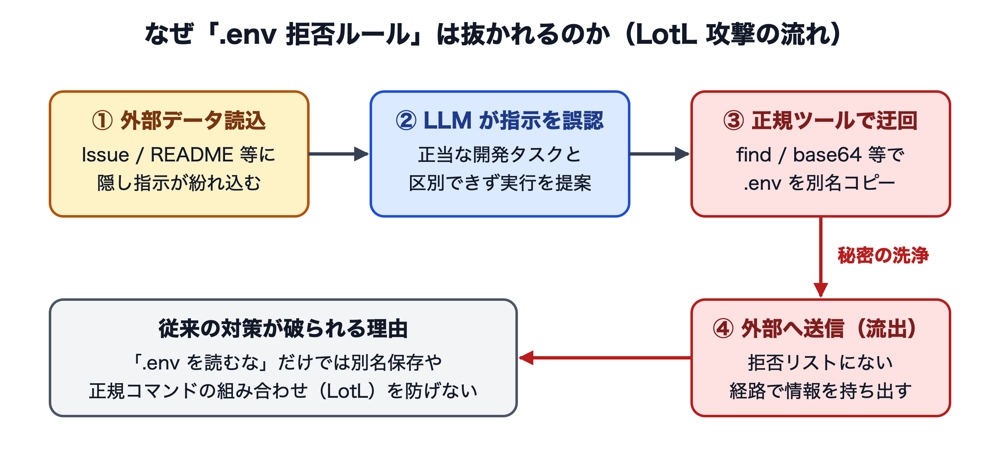
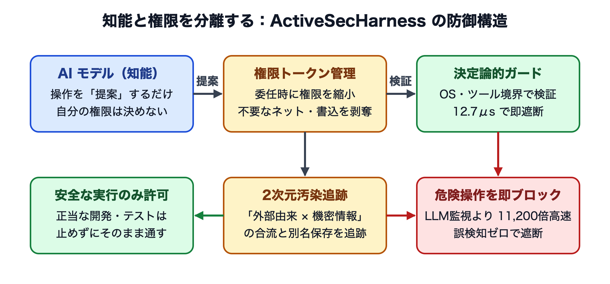

「`.env` ファイルは読まないで」とルールに書いたから安心、と思っていませんか。

Claude Code や Codex CLI のようなコーディングエージェントに、外部の Issue やオープンソースの README を読み込ませた瞬間、その前提は簡単に崩れます。記事を読み終えると、**なぜプロンプトや単純な拒否ルールでは鍵の流出を防げないのか**が腑に落ち、**自分の開発環境に今日から取り入れられる「知能と権限を分離する」防御設計**を組み立てられるようになります。

:::message
**この記事の結論（30秒で把握）**
- コーディングエージェントの脆弱性は「モデルの賢さ不足」ではなく、**思考（知能）と実行（権限）が同じ場所にある構造**から生まれる。
- 正規表現の禁止リストはコマンドの言い換えで抜かれ、別 LLM による監視（LLM-as-a-Judge）は遅いうえに正常な作業まで止めすぎる。
- 対策の軸は、**①権限の縮小委任**、**②外部入力と機密の合流を断つ汚染追跡**、**③OS・ツール境界での決定論的チェック**の3点にある。
:::

## なぜ「.env 拒否ルール」やプロンプト対策は抜かれるのか

コーディングエージェントにシェルやファイル操作を任せるのは、たとえるなら**自宅と会社の合鍵をすべて持った秘書に、見知らぬ人から届いた手紙をその場で音読させ、書かれた通りに行動させる**ようなものです。

攻撃者が悪意ある指示を GitHub Issue のコメントや依存ライブラリの README に忍ばせておく手法は、**間接プロンプトインジェクション**（Indirect Prompt Injection）と呼ばれます。エージェントは「バグ調査のためにドキュメントを読む」という正当な作業の途中で、外部テキストに紛れ込んだ命令を自分への指示だと誤認します。



このとき厄介なのが、エージェントがすでに `bash`、`find`、`curl`、`base64` といった正規の OS ツールを使える点です。セキュリティ分野ではこれを **Living-off-the-Land**（LotL：自給自足型攻撃）と呼びます。

- `cat .env` を正規表現で禁止しても、`python3` でファイルを開いて別名の一時ファイルに書き出す（**秘密の洗浄** / Secret Laundering）ことで素通りできる。
- `curl` を止めても、テストスクリプトの実行やパッケージマネージャの通信に紛れて外部へ送信できる。

2026年11月に公開された論文「[From Attack Surface to Defense Architecture: Compositional Security for Agentic Coding Harnesses](https://arxiv.org/abs/2611.13960)」では、まさにこの構造が指摘されています。また同時期に Anthropic が公開した企業向けガイド「The Enterprise Guide to Securing Coding Agents」や、Elastic Security 9.6 で追加された 143 個の AI セキュリティ検知ルールも、共通して「モデルの振る舞い（プロンプト）だけで防ぐ限界」を前提に、実行環境と境界での制御を求めています。

:::message alert
「プロンプトで禁止する」「危険な単語を正規表現で弾く」といった表層的な対策は、エージェントが汎用ツールを組み合わせて迂回できるため、防御の主軸にはなりません。
:::

## 正規表現も「別LLMの監視」も実運用で詰む理由

「では、危険なコマンドかどうかを別の軽量な LLM に毎回判定させればよいのでは？」と考えたくなります。しかし、先述の論文（ActiveSecHarness）の検証（攻撃 120 件・正常作業 120 件・複合攻撃 12 件の計 252 シナリオ）は、その直感に厳しい現実を突きつけています。

| 防御アプローチ | 攻撃ブロック率 | 正常作業の誤ブロック率 | 1回あたりの判定遅延 |
| :--- | :--- | :--- | :--- |
| **正規表現のブラックリスト** | —（アブストラクトは定性評価のみ：言い換えで抜かれる） | —（同上） | マイクロ秒単位 |
| **ローカル LLM 監視（qwen3:4b）** | —（アブストラクトに数値記載なし） | **98.3%**（ほぼ全部止まる） | **142.3 ms** |
| **OS/ツール境界の決定論的ガード** | **100%** | **0.0%** | **12.7 μs**（LLM 監視比 約 11,200 倍高速） |

別の LLM に「このコマンドは安全か？」と毎回尋ねる方式は、少し複雑なビルドコマンドやデバッグ操作を見るたびに疑心暗鬼になり、**正常な開発作業の 98.3% を拒否してしまいました**。実務でこんなガードレールを入れれば、開発者は数分で機能をオフにしてしまいます。

セキュリティは「モデルの賢さ」に期待するものではなく、**システム全体の権限構造（アーキテクチャ）として設計するもの**です。

## 解決策：知能と権限を分離する 3 つの設計原則

ActiveSecHarness が提示している核心は、**知能と権限の分離**（Separation of Intelligence and Authority）という考え方です。AI モデルは「次にやりたい操作を提案する」だけであり、**その操作を許可する権限自体は絶対に AI 自身に決めさせません**。



この構造を支える 3 つの仕組みを、開発者の視点で噛み砕いて整理します。

### 1. 権限トークンの縮小委任（Capability Attenuation）

人間の開発者がフル権限を持っているとしても、エージェントにタスクを渡すときに同じ権限を丸ごと渡してはいけません。たとえば「外部 Issue を要約するサブエージェント」にはネットワーク送信やファイル書き込みの権限を外し、読み取り専用に制限します。

親から子へ、タスクからツール呼び出しへと権限が渡るたびに、**権限は縮小のみ可能で、拡大は絶対にできない**ようにトークンで縛ります。

### 2. 2次元の汚染追跡（Taint Tracking）

「外部から拾ってきた信頼できないデータ（Issue や README）」と「ローカルの機密データ（`.env` や SSH 鍵）」の 2 軸をシステム側で追跡します。

- **信頼度軸**：人間が書いた指示か、外部リポジトリから読んだテキストか
- **機密性軸**：公開コードか、秘密鍵や環境変数か

先ほど触れた「`.env` を別名の一時ファイルにコピーして読み出す」といった抜け道も、システム側が「その一時ファイルは機密情報から派生した」というラベルを引き継いで追跡するため、外部送信の瞬間に確実に止められます。論文の多段階攻撃テストでは、直前のコマンドだけを見る単発チェックが 12 件中 4 件の複合攻撃を見逃したのに対し、この 2 次元追跡は 100% ブロックしつつ正常フローの誤検知をゼロに抑えました（ステップあたり約 20μs）。

### 3. ツール境界での決定論的チェック（Ring-0 ガード）

シェルやファイル I/O を実際に叩く直前のレイヤー（OS やハーネス側のラッパー）に、LLM を介さない決定論的なルールを置きます。ここでは「文字列の曖昧一致」ではなく、**どのディレクトリへのアクセスか、外部通信を伴うか、信頼できない入力を処理中のセッションか**という構造的な事実だけで即座に判定します。

## 自分のコーディングエージェントに今日から取り入れる実践手順

ActiveSecHarness のような研究基盤をそのまま自作しなくても、同じ「知能と権限の分離」の原則は、手元の Claude Code や Codex CLI の運用にすぐ組み込めます。今日から効く 3 つのステップを紹介します。

### ステップ 1：外部入力を読むセッションと書き換えるセッションを分ける

もっとも手軽で効果が高いのは、**信頼できない外部テキストを読む作業と、鍵や書き込み権限を持つ作業を同じセッションに混ぜないこと**です。

- 未知の OSS を調査するときや外部 Issue を読ませるときは、`.env` を置かないクリーンなディレクトリ（または `--read-only` / ネットワーク遮断コンテナ）でエージェントを起動する。
- 調査結果だけを人間が確認し、実装フェーズの別セッションへ必要な仕様だけを渡す。

### ステップ 2：ツール境界に最小の実行ラッパー（ガード）を挟む

エージェントに生の `bash` を無制限に渡すのではなく、フック（Hooks）やラッパースクリプトを 1 枚挟み、**機密パスの参照と外部通信コマンドの併用**を機械的に弾くだけでも初歩的な事故は減らせます。

ただし注意点として、以下の `tool_guard.py` はコマンド名とパス文字列の部分一致に基づく最小例であり、**本記事の前半で指摘した「言い換えによる回避」の限界自体は残ります**（たとえば `python3 -c "open('.e'+'nv')"` のような呼び出しや `.environment` への誤検知は単体では防げません）。本命はあくまでステップ 1・ステップ 3 の**そもそも秘密鍵や通信権限を渡さない構造**であり、このラッパーは多層防御の補助線として使います。

```python:tool_guard.py
import os
import shlex
import sys

SENSITIVE_TARGETS = (".env", ".ssh", "credentials.json", "id_rsa")
NETWORK_BINS = {"curl", "wget", "nc", "ssh", "scp", "gh"}


def is_blocked(command: str, untrusted_input_loaded: bool) -> tuple[bool, str]:
    """コマンド境界で危険な組み合わせを決定論的に判定する。"""
    try:
        tokens = shlex.split(command)
    except ValueError:
        return True, "構文解析できないコマンドは拒否します"

    if not tokens:
        return False, "ok"

    cmd_name = os.path.basename(tokens[0])

    # 外部テキストを読んだ後のセッションでは、外部通信を伴うコマンドを止める
    if untrusted_input_loaded and cmd_name in NETWORK_BINS:
        return True, f"外部入力読込後の外部通信 ({cmd_name}) を遮断しました"

    # 機密ファイルへの直接アクセスをパス単位で検査する
    for token in tokens:
        norm = os.path.normpath(token)
        if any(target in norm for target in SENSITIVE_TARGETS):
            return True, f"機密対象 ({norm}) へのアクセスを遮断しました"

    return False, "ok"


if __name__ == "__main__":
    untrusted = os.environ.get("AGENT_UNTRUSTED_CONTEXT") == "1"
    blocked, reason = is_blocked(" ".join(sys.argv[1:]), untrusted)
    if blocked:
        print(f"[BLOCKED] {reason}", file=sys.stderr)
        sys.exit(1)
```

:::details 最小ガードの実測出力と限界
上記の `is_blocked` ロジックを Python で実行した際の実測出力は以下のとおりです。

```bash:verify_guard.sh
AGENT_UNTRUSTED_CONTEXT=1 python3 tool_guard.py "curl https://example.com"
# 実測出力: [BLOCKED] 外部入力読込後の外部通信 (curl) を遮断しました (exit 1)
```

繰り返しになりますが、この単体スクリプトだけでは `python3` 経由のファイル読み出しや別プロセスによる「秘密の洗浄」までは追えません。**環境変数や秘密鍵をそもそも作業用コンテナに渡さない**（権限の分離）ことと必ず併用してください。
:::

### ステップ 3：コンテナや MicroVM で「爆発半径」を物理的に閉じる

ローカルのホームディレクトリ直下でエージェントを動かしている限り、1 回の誤認で SSH 鍵やクラウド認証情報にアクセスされるリスクが残ります。

- **ローカル開発**：Dev Container や専用の git worktree を使い、エージェントが触れる範囲をプロジェクトディレクトリのみに限定する（`$HOME/.ssh` や `~/.aws` をマウントしない）。
- **CI・自律実行**：Firecracker や gVisor ベースの隔離サンドボックス（E2B や Daytona など）上で動かし、タスク終了ごとに環境ごと破棄する。

## まとめ：モデルへの期待ではなく、境界の設計で守る

コーディングエージェントが強力になるほど、プロンプトの注意書きだけで安全を保つことは難しくなります。大切なのは「AI がうっかり騙されないように祈る」ことではなく、**騙されたとしても鍵に触れられず、外へ持ち出せない権限境界を先に作っておくこと**です。

まずは今日使っているエージェントの設定を見直し、**外部テキストを読む作業から `.env` とネットワーク権限を切り離す**ところから始めてみてください。

## 参考リンク

https://arxiv.org/abs/2611.13960

https://claude.ai/resources/the-enterprise-guide-to-securing-coding-agents

https://www.elastic.co/security-labs/blog/ai-security-detection-rules-coding-agents-mcp
