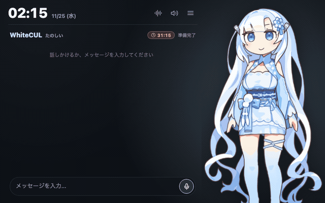
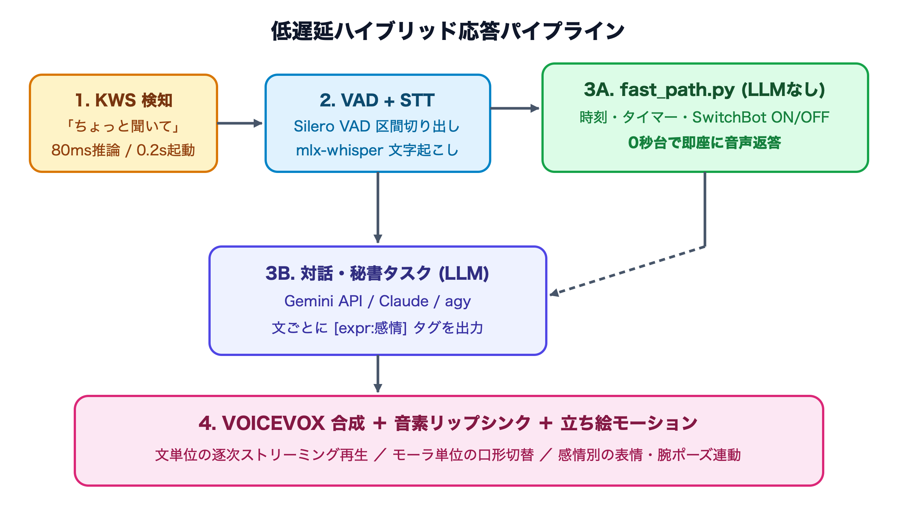

机の隅で眠っていた Echo Show 5（第1世代）を、ローカル音声認識（Whisper）＋ LLM ＋ VOICEVOX ＋ 立ち絵キャラクターが動く **専用の AI 音声アシスタント端末** に作り変えました。

この記事を読むと、**古いスマートディスプレイを文鎮化させずに自作 Web 端末として再利用する設計** と、**0.2 秒起動のカスタムウェイクワード・0 秒台ファストパス・音素リップシンクを備えた音声アシスタント「VoxMate」の作り方** を自分の環境へ取り入れられるようになります。



:::message
**この記事で作るもの（VoxMate）**
- **端末**: Echo Show 5 第1世代（LineageOS 18.1 + Chrome）＋ PC・スマホで同期
- **音声認識**: Apple Silicon 上の `mlx-whisper` + Silero VAD + 自前学習した `openWakeWord`（「ちょっと聞いて」）
- **頭脳**: 0 秒台で即答する決定論的ファストパス ＋ 差し替え可能な LLM バックエンド（公式 Gemini API / Claude Code / Antigravity CLI）
- **表現**: VOICEVOX 音声合成 ＋ 音素タイムライン連動の5母音リップシンク ＋ 感情タグ連動の立ち絵モーション
:::

公開リポジトリは以下です。本記事の構築後に、利用規約面でクリーンに常時運用しやすい公式 Gemini API バックエンド（`v0.1.3`）も追加しました。

https://github.com/Naruto-Takahashi/voxmate

## 全体アーキテクチャと端末ごとの役割分担

Echo Show 5（第1世代）はメモリ 1GB 前後の非力なハードウェアですが、「**画面表示とマイク・スピーカー I/O だけを担当するシンクライアント**」と割り切れば、驚くほど快適に動きます。重い音声認識や音声合成、LLM 推論はすべて母艦の Mac mini（M1 8GB）側に集約しました。


接続経路を 2 系統に分けているのが運用上のポイントです。

- **Echo Show 5**（USB 常時接続）：`start.sh` が `adb reverse tcp:8000 tcp:8000` を常時維持するため、端末上の Chrome からは `http://localhost:8000` で直接アクセスできます。ブラウザのマイク API（`getUserMedia`）は通常 HTTPS 必須ですが、`localhost` なら自己署名証明書なしで動作します。
- **PC・スマートフォン**（外出先・別室）：Tailscale Serve 経由で HTTPS 公開し、家庭内 LAN や外出先から安全に同じセッションへ接続できます。アラームの停止操作やタイマー、会話履歴も WebSocket で全端末にリアルタイム同期されます。

## Echo Show 5 第1世代のブートローダーアンロックと LineageOS 導入

Echo Show 5 第1世代（コードネーム `checkers` / MediaTek MT8163）は、一度はファームウェア更新で塞がれたはずのブートローダーアンロック用脆弱性（`fastbrick`）が、後のビルド `Fire OS 6575.1 (NS65751/8851)` で **リバート（巻き戻し）されて再び使えるようになっていた** ことが XDA Developers のスレッドで報告されていました。

手元の端末を確認するとまさに `NS65751/8851` だったため、これを利用して Android 11 ベースの LineageOS 18.1 を導入しました。

:::message alert
**改造・アンロックに関する注意**
ブートローダーアンロックおよびカスタム ROM 導入はメーカー保証の対象外となり、手順を誤ると端末が起動しなくなる（文鎮化する）リスクがあります。本記事は所有端末での個人検証記録であり、実施する場合は自己責任のもと、必ず一次スレッドの最新手順と対象ビルドを確認してください。なお、ツールの再配布は行いません。
:::

手順の概要は以下の通りです。

1. **自動アップデート遮断**: まず Wi-Fi をオフにし、Amazon の強制 OTA 更新で対策済みビルドへ上がらないようにする。
2. **USB ドライバとアンロック**: Windows PC に Google USB Driver を入れ、`amonet-checkers-v2.0.2`（`fastbrick.bat`）でブートローダーをアンロックし、TWRP リカバリを導入する。
3. **LineageOS 18.1 の焼成**: TWRP から `checkers` 向けの LineageOS 18.1 と Chrome を導入し、余計な常駐アプリを省いた軽量なキオスク端末として仕上げる。

詳細なツールと実機報告は XDA Developers の公式スレッドにまとまっています。

https://xdaforums.com/t/unlock-root-twrp-unbrick-echo-show-5-checkers.4718281/

## 低遅延ハイブリッド応答パイプラインの設計

音声アシスタントを使っていて一番ストレスになるのは「今何時？」のような単純な問いかけに毎回数秒待たされることです。VoxMate では、**決定論的ファストパス** と **LLM ストリーミング** を組み合わせたハイブリッド構成で体感を高速化しています。



### 1. 決定論的ファストパス（`fast_path.py`）で 0 秒台即答

現在時刻・日付、タイマーやアラームの登録・確認・キャンセル、SwitchBot の単純な ON/OFF は LLM を一切経由せず、正規表現とキャッシュ済みデバイス一覧で即座に処理します。キャラクターごとの語尾（ずんだもんの「〜のだ！」、四国めたんの「〜ですわ！」など）もローカル側で整形して返します。

### 2. 差し替え可能な AI バックエンド（`backends/`）

雑談やカレンダー確認・要約などの柔軟なタスクは、`VOXMATE_BACKEND` 環境変数で切り替えられるバックエンド層に委譲します。

```python:backends/__init__.py
_BACKENDS = {
    "agy": PersistentAgySession,
    "claude": ClaudeCodeSession,
    "gemini": GeminiApiSession,
}


def create_backend_session(
    workdir: Path,
    default_speaker_id: int,
    build_preamble_fn: Callable[[int], str],
    describe_step_fn: Callable[[dict], str],
    clean_for_speech_fn: Callable[[str], str],
):
    backend = os.environ.get("VOXMATE_BACKEND", "agy").strip().lower()
    cls = _BACKENDS.get(backend, PersistentAgySession)
    return cls(
        workdir=workdir,
        default_speaker_id=default_speaker_id,
        build_preamble_fn=build_preamble_fn,
        describe_step_fn=describe_step_fn,
        clean_for_speech_fn=clean_for_speech_fn,
    )
```

:::message alert
**AI バックエンド選定と利用規約上の注意**
開発中は手元の Antigravity CLI（`agy`）や Claude Code CLI（`claude`）の常駐セッションでもテストしましたが、Google Antigravity の利用規約（`antigravity.google/terms`）にはサードパーティ製ツールとの接続や自動連携を制限する条項があります。
常時稼働の音声アシスタントとして安全・クリーンに運用したい場合は、公式 API キーを使う **Gemini API バックエンド（`VOXMATE_BACKEND=gemini`）** の利用を強く推奨します。
:::

`GeminiApiSession`（`backends/gemini.py`）は `GEMINI_API_KEY` と `httpx` の SSE ストリーミングだけで動作するため、追加の重量級 SDK なしでキャラクター口調（`systemInstruction`）とマルチターン会話に対応できます。

## openWakeWord で 0.2 秒反応の「ちょっと聞いて」を自作する

初期実装では「無音を検知してから Whisper で文字起こしし、先頭にウェイクワードが含まれるか判定する」方式にしていました。しかしこの方法では、**呼びかけから返答チャイムが鳴るまで約 2.5 秒のラグ** が発生してしまいます。

そこで `openWakeWord` を使い、全キャラクター共通のウェイクワード **「ちょっと聞いて」** を検知する超軽量モデル（`Conv1d` ベース、約 460KB の ONNX モデル）を M1 Mac mini 上の PyTorch で学習しました。

- **学習データの作成**: VOICEVOX 全話者から生成した合成音声約 2,000 件に加え、VoxMate 上に用意した専用録音ページ `/kws` で自分の生声（ポジティブ 25 件・ネガティブ 10 件）を収集して学習データに混ぜています。
- **リアルタイム推論**: ブラウザから `/ws/kws` WebSocket へ 80ms ごとに音声フレームを送り、検知した瞬間に **約 0.2 秒以内** で起動チャイムを鳴らして本録音へ移行します。
- **実測精度**: オーナーの生声テストでポジティブ 25/25 検知、ネガティブ誤検知 0/10 を達成しました。

## VOICEVOX 音素リップシンクと立ち絵モーションの実装

音声アシスタントを「ただの箱」から「デスクの相棒」に変えるため、立ち絵アニメーションの作り込みにもこだわりました。

### PSD から 25 種類の差分を共通座標で抽出

`tools/extract_portraits.py` を使い、坂本アヒル氏の立ち絵 PSD から全 12 キャラクター分・各 25 枚の PNG を共通バウンディングボックス基準で自動抽出しています（待機・まばたき・5 母音・考え中・8 感情 × 開閉口）。画像サイズと位置が完全に揃っているため、ブラウザ側では `` の `src` を切り替えるだけで位置ズレなくアニメーションします。

### 音素タイムラインと `[expr:...]` タグの連動

LLM には文ごとに `[expr:happy]` や `[expr:shy]` のような感情タグを出力させ、バックエンドからテキストを受け取った瞬間にタグを剥がして表情・腕ポーズ・控えめな CSS モーションを切り替えます。

同時に、VOICEVOX Engine の `audio_query` が返すモーラごとの子音長・母音長から `[開始ms, 口形状]` のタイムラインを生成し、Web Audio API の再生時刻と同期して **「あ・い・う・え・お」＋口閉じの 6 状態リップシンク** を動かしています。感情表情の発話中も口閉じ差分（`<表情>_c`）へ切り替えることで、腕ポーズや眉がチラつかずに口元だけを自然に動かせます。

## まとめと利用クレジット

古い Echo Show 5 をシン・クライアント化し、重い推論を母艦に逃がしつつ「ファストパス」「専用 KWS」「音素リップシンク」を組み合わせることで、実用的な速度と愛着の湧く対話体験を両立できました。

手元に余っているスマートディスプレイや Raspberry Pi がある方は、ぜひ `VOXMATE_BACKEND=gemini` を設定して自分だけの音声アシスタント環境を試してみてください。

:::message
**立ち絵素材・音声合成クレジットとライセンス**
- **立ち絵素材**: 坂本アヒル氏 配布素材（[利用規約・ガイドライン](https://zan-shin.net/guideline/) / [東北ずん子・ずんだもん公式ガイドライン](https://zunko.jp/guideline.html)）。本リポジトリおよび記事内では PSD・PNG 素材の再配布は行っておらず、各配布元の規約に従ってローカル環境に配置する構成としています。
- **音声合成**: [VOICEVOX](https://voicevox.hiroshiba.jp/)
:::

## 参考リンク

https://github.com/Naruto-Takahashi/voxmate

https://xdaforums.com/t/unlock-root-twrp-unbrick-echo-show-5-checkers.4718281/

https://antigravity.google/terms
