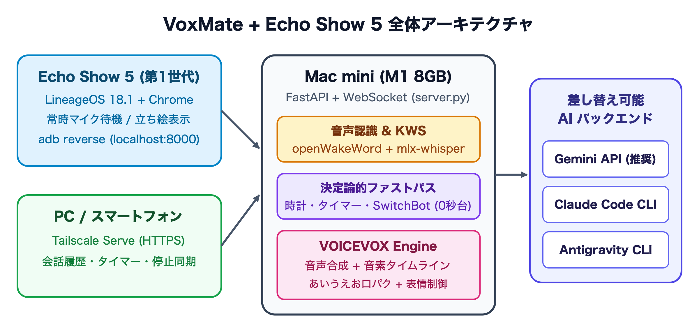

机の隅で眠っていた Echo Show 5（第1世代）を、ローカル音声認識（Whisper）＋ LLM ＋ VOICEVOX ＋ 立ち絵キャラクターが動く **専用の AI 音声アシスタント端末** に作り変えました。

純正のスマートディスプレイは便利ですが、「好きなキャラクターの声と立ち絵で対話したい」「自分のローカル環境やカレンダー・スマートホームと自由に連携させたい」となると制約が多くなります。そこで、Echo Show 5 を Android 端末化してシンクライアントとして動かし、母艦の Mac mini 上で動かす音声アシスタント **VoxMate** を自作しました。

この記事では、**Echo Show 5 のアンロックから VoxMate のセットアップ・0.2 秒ウェイクワード学習・運用カスタマイズまでの全手順** を、実際につまずいたポイントとあわせて紹介します。


https://github.com/Naruto-Takahashi/voxmate

## 全体構成：なぜ Echo Show 5 側で推論しないのか

Echo Show 5（第1世代）はメモリが 1GB 前後と小さく、音声認識や TTS を端末単体で動かすのは現実的ではありません。そこで役割を割り切り、**端末側は Chrome で画面表示とマイク・スピーカー入出力だけを担当** させ、重い処理はすべて母艦（Mac mini M1 8GB）側に集約しました。



接続経路には少し工夫を入れています。ブラウザのマイク API（`getUserMedia`）はセキュリティ仕様上、HTTPS または `localhost` でないとブロックされてしまいます。LAN IP（`http://192.168.x.x:8000`）で開くと自己署名証明書の手間が出るため、Echo Show 5 は USB 経由の `adb reverse` で `http://localhost:8000` として接続し、外出先のスマホや別 PC からは Tailscale Serve（HTTPS）で繋ぐ構成にしました。

## 手順1：Echo Show 5 第1世代のアンロックと LineageOS 18.1 導入

Echo Show 5 第1世代（コードネーム `checkers`）は、一度はファームウェア更新で塞がれたブートローダーアンロック用脆弱性（`fastbrick`）が、後のビルド `Fire OS 6575.1 (NS65751/8851)` でリバート（巻き戻し）されて再アンロック可能になっていたことが XDA Developers で報告されています。手元の端末もまさに該当ビルドだったため、このタイミングを逃さず LineageOS 18.1 へ入れ替えました。

:::message alert
**改造・アンロックに関する注意**
ブートローダーアンロックおよびカスタム ROM 導入はメーカー保証の対象外となり、手順を誤ると端末が起動しなくなる（文鎮化する）リスクがあります。実施する場合は自己責任のもと、必ず XDA の一次スレッドで最新手順と対象ビルドを確認してください。なお、ツールの再配布は行いません。
:::

1. **対象ビルドの確認と OTA 遮断**: 「設定」→「デバイスオプション」→「デバイス情報」で `Fire OS 6575.1 (NS65751/8851)` であることを確認したら、**即座に Wi-Fi をオフ** にして Amazon の自動アップデートで対策済みビルドへ上がらないよう遮断します。
2. **Windows でアンロックと TWRP 導入**: XDA スレッドから `amonet-checkers-v2.0.2` と LineageOS 18.1 イメージを入手し、Google USB Driver を導入した Windows PC で `fastbrick.bat` を実行します。指示に従って電源オフ状態で USB 接続し、アンロック完了後に TWRP リカバリを起動します。
3. **LineageOS 18.1 の焼成**: TWRP の「Wipe」→「Advanced Wipe」で Data / Cache を初期化したうえで、PC から ROM を転送してインストールします。

```bash:lineageos-flash.sh
adb push lineage-18.1-*-UNOFFICIAL-checkers.zip /sdcard/
# TWRP の「Install」から上記 ZIP を選択して焼成し、再起動する
```

4. **USB デバッグ有効化**: 起動後、「設定」→「端末情報」→「ビルド番号」を 7 回タップして開発者向けオプションを開き、USB デバッグを ON にします。最後に Chrome を導入すれば端末側の準備は完了です。

https://xdaforums.com/t/unlock-root-twrp-unbrick-echo-show-5-checkers.4718281/

## 手順2：母艦（Mac mini / PC）に VoxMate をセットアップする

母艦側では Python 3.12+、[`uv`](https://docs.astral.sh/uv/)、`ffmpeg`、`jq`、`adb` を用意します。

### 2-1. クローンと依存パッケージの同期

```bash:setup-voxmate.sh
git clone https://github.com/Naruto-Takahashi/voxmate.git
cd voxmate
uv sync
```

Apple Silicon Mac では高速な `mlx-whisper`、Linux / Windows では `faster-whisper` が環境に応じて自動インストールされます。

### 2-2. VOICEVOX Engine の準備

- **macOS (Apple Silicon)**: [VOICEVOX Engine Releases](https://github.com/VOICEVOX/voicevox_engine/releases) から `voicevox_engine-macos-arm64-*.tar.gz` を取得し、解凍した中身（`run` 実行ファイル一式）を `voicevox/macos-arm64/` に配置します（`./start.sh` が自動起動します）。
- **Linux / Windows**: Docker 等で `http://127.0.0.1:50021` に待ち受けさせます。

```bash:voicevox-docker.sh
docker run --rm -p 50021:50021 voicevox/voicevox_engine:cpu-latest
```

### 2-3. AI バックエンド設定（`.env`）

VoxMate は `VOXMATE_BACKEND` 環境変数で AI バックエンドを差し替えられます（`gemini` / `claude` / `agy`）。

:::message alert
**AI バックエンド選定と利用規約上の注意**
開発当初は普段使っている Antigravity CLI（`agy`）や Claude Code CLI（`claude`）のセッションをそのまま音声化していましたが、Google Antigravity の利用規約（`antigravity.google/terms`）にはサードパーティ製ツールとの接続を制限する条項があります。常時稼働の音声アシスタントとして安心して使い続けられるよう、公開にあたって公式 API キーを使う **Gemini API バックエンド（`VOXMATE_BACKEND=gemini`）** を追加しました。通常運用はこちらを推奨します。
:::

`.env.example` をコピーして `.env` を作成し、API キーを設定します。

```bash:.env
VOXMATE_BACKEND=gemini
GEMINI_API_KEY=your_gemini_api_key_here
GEMINI_MODEL=gemini-2.5-flash

VOICEVOX_URL=http://127.0.0.1:50021
VOICEVOX_SPEAKER=3
```

### 2-4. 起動と端末からの接続

```bash:run-voxmate.sh
# macOS（VOICEVOX Engine + VoxMate + adb reverse を一括維持）
./start.sh

# Linux / Windows（外部で VOICEVOX Engine 起動済みの場合）
uv run python -m uvicorn server:app --host 127.0.0.1 --port 8000
```

- **Echo Show 5**: USB 接続した状態で Chrome から `http://localhost:8000` を開きます（`start.sh` が `adb reverse tcp:8000 tcp:8000` を張り直してくれます）。初回のみマイク権限を許可してください。
- **スマホ・他 PC**: Tailscale を使っている場合は `tailscale serve --bg 8000` で HTTPS 公開すると、別室や外出先からも会話履歴やアラーム停止操作をリアルタイム同期できます。

## 手順3：実用テンポを作るウェイクワード学習と立ち絵連携

### 3-1. 2.5 秒のラグを消したカスタムウェイクワード（`openWakeWord`）

最初は「無音検知 → Whisper で文字起こし → 先頭ワード判定」という素朴な方法で呼びかけを検知していましたが、話しかけてから反応するまで **約 2.5 秒のラグ** があり、どうにも会話のテンポが合いませんでした。

そこで `openWakeWord` を使い、全キャラ共通の呼びかけ **「ちょっと聞いて」** を検知する超軽量 ONNX モデル（`models/chotto_kiite.onnx`、約 460KB）を自作しました。`/ws/kws` へ 80ms ごとに音声フレームを送ることで、呼びかけから **約 0.2 秒以内** に起動チャイムが鳴るようになります。

学習済みモデルを同梱しているためすぐ使えますが、自分の声や環境音に合わせて再学習したい場合は以下の 3 ステップで更新できます。

```bash:train-kws.sh
# 1. VOICEVOX 全話者から合成音声データを生成
uv run python tools/kws_generate.py --pos 800 --neg 1200 --out-dir data/kws

# 2. ブラウザで http://localhost:8000/kws を開き、自分の生声を録音して追加する

# 3. PyTorch で Conv1d モデルを学習し ONNX 化する
uv run python tools/kws_train.py --data-dir data/kws --out models/chotto_kiite.onnx --epochs 35
```

### 3-2. 立ち絵の抽出と音素リップシンク（`extract_portraits.py`）

立ち絵画像がなくてもキャラクターカラーのプレースホルダーで動作しますが、坂本アヒル氏の立ち絵 PSD（各自で規約に従って入手したもの）を `custom_psd/` に配置すると、全 12 キャラクター・各 25 枚の差分 PNG を共通座標で自動抽出できます。

```bash:extract-portraits.sh
uv run python tools/extract_portraits.py --psd-dir custom_psd --out-dir static/portraits
```

抽出後は、LLM が出力する `[expr:happy]` などの感情タグと VOICEVOX の `audio_query`（音素タイムライン）が連動し、発話に合わせて「あ・い・う・え・お」の口パクと感情モーションが自然に動きます。

### 3-3. 自分の秘書機能へ拡張する（`fast_path.py` / `examples/`）

「今何時？」「3分後にタイマーかけて」のような定型操作は `fast_path.py` が LLM を通さず 0 秒台で即答します。さらに SwitchBot による家電操作や Google カレンダー・メール要約などを足したい場合は、リポジトリ内の `examples/` にあるテンプレートと `VOXMATE_WORKDIR` を使って自分の環境向けプロンプトやツールを安全に分離・追加できます。

## まとめと利用クレジット

余っていた Echo Show 5 をシン・クライアント化し、母艦に `mlx-whisper` + `openWakeWord` + `VOICEVOX` + 差し替え可能な LLM バックエンドを集約することで、手元のデスクに置ける実用的な AI 相棒に生まれ変わりました。古いスマートディスプレイの活用先を探している方は、ぜひ `VOXMATE_BACKEND=gemini` の構成から試してみてください。

:::message
**立ち絵素材・音声合成クレジットとライセンス**
素晴らしい立ち絵素材と音声合成エンジンを公開してくださっているクリエイター・開発者の皆様に感謝します。
- **立ち絵素材**: 坂本アヒル氏 配布素材（[利用規約・ガイドライン](https://zan-shin.net/guideline/) / [東北ずん子・ずんだもん公式ガイドライン](https://zunko.jp/guideline.html)）。本リポジトリおよび記事内では PSD・PNG 素材の再配布は行っていません。
- **音声合成**: [VOICEVOX](https://voicevox.hiroshiba.jp/)
:::

## 参考リンク

https://github.com/Naruto-Takahashi/voxmate

https://xdaforums.com/t/unlock-root-twrp-unbrick-echo-show-5-checkers.4718281/

https://antigravity.google/terms
