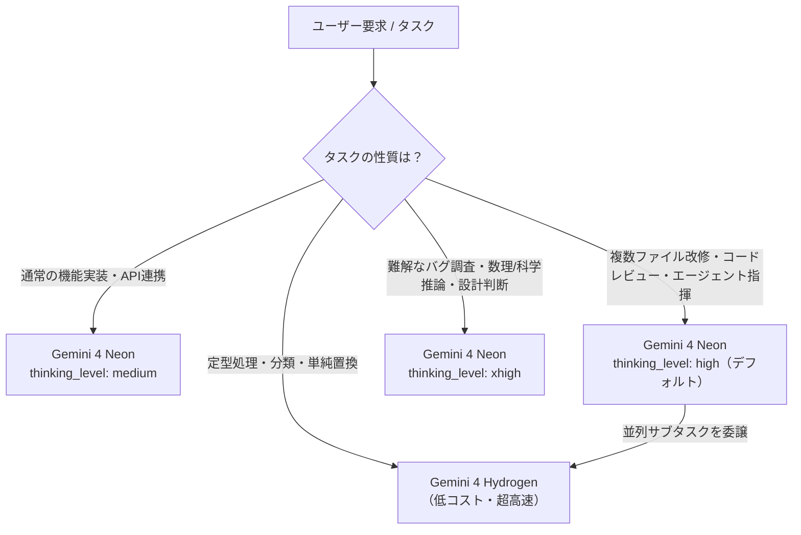

2026年11月18日（米国時間）、GoogleおよびGoogle DeepMindは新モデル **Gemini 4 Neon**（モデルID: `gemini-4-neon`）を発表しました。最上位の「Gemini 4 Carbon」をベースに適応・開発され、高い推論力と高速な応答・中位帯のコストを両立したモデルです。

本記事では、単なるリリース要約にとどまらず、**Gemini 4ファミリー（Hydrogen / Neon / Carbon）の使い分け基準**、**4段階の `thinking_level`（`low`〜`xhigh`）を用いたタスクルーティング設計**、そして **Context Caching（95%オフ）を活用した実務向けのコスト最適化パターン** を、一次ソースと `google-genai` SDK の実装例を交えて解説します。

:::message
本記事は2026年11月時点の公式発表・ドキュメントに基づいています。記事内のコード例は公式API仕様に沿った実装パターンであり、実行にあたっては有料のAPI課金設定（またはGoogle AI Pro / Ultra等の対応プラン）が必要です。
:::

## 1. Gemini 4 Neonとは何か：3階層ラインナップにおける立ち位置

GoogleのGemini 4ファミリーは、用途とコストのトレードオフに応じて元素名を冠した階層構造をとっています。Neonは、軽量高速な **Hydrogen** と、最難関タスク向けの **Carbon** のちょうど中間に位置づけられます。

| モデル名 | 位置づけ | 主な得意領域 | 特徴・トレードオフ |
| :--- | :--- | :--- | :--- |
| **Gemini 4 Hydrogen** | 軽量・高速 | 日常のコーディング、スクリプト生成、高スループット処理、サブエージェント | 圧倒的な低コスト・低レイテンシ（Neonの約半額帯） |
| **Gemini 4 Neon** | 中位・バランス型 | 複雑なソフトウェア開発、分析推論、科学的ワークフロー、オーケストレータ | Carbon譲りの推論力と約2倍の速度を両立。4段階の思考レベルに対応 |
| **Gemini 4 Carbon** | 最上位・フラッグシップ | 長期・超複雑な設計、高度なデバッグ、専門的なセキュリティ/科学研究 | 最高峰の安定性と深い推論。入力$4.00 / 出力$20.00（1Mトークンあたり） |

### 注目すべきベンチマークと実用性能

独立評価機関である Artificial Analysis の Intelligence Index において、Gemini 4 Neon は最大思考レベル（`xhigh`）設定時にスコア **61** を記録しています。これは最上位モデルの Gemini 4 Carbon（約60）や Claude Opus 5.5（約59）に匹敵・上回る水準でありながら、生成速度は Carbon の約2倍（約110〜127 tokens/sec）で動作すると報告されています。

特に実務で効いてくるのは、以下の3点です。

1. **1M（100万）トークンのユニファイドコンテキストウィンドウ**: 巨大なコードベースや複数ドキュメントをそのままコンテキストに載せられます。
2. **マルチステップの指示追従性とステアビリティ**: 開発者からの修正指示や制約条件を途中で見失いにくく、エージェントループの司令塔（オーケストレータ）に適しています。
3. **思考レベル（Thinking Levels）による動的制御**: 1つのモデルID（`gemini-4-neon`）のまま、推論の深さをリクエストごとに調整できます。

## 2. 料金体系とContext Cachingのインパクト

Gemini 4 Neon の API 料金（100万トークンあたり）は以下の通りです。

* **入力トークン**: `$3.00`
* **キャッシュ済み入力トークン（Context Caching）**: `$0.15`（通常入力から **95%オフ**）
* **出力トークン（思考トークンを含む）**: `$15.00`

※ `gemini-4-neon` には無料API枠が設定されていないため、Google AI Studio での有料課金または Google AI Pro / Ultra 等の対応プランでの利用となります。

ここで最も重要な設計ポイントは、**「思考トークン（Thinking Tokens）も出力トークン（$15.00 / 1M tokens）として課金される」** という点です。つまり、すべてのリクエストを最高思考レベルにすると、レイテンシだけでなく出力コストも大きく膨らみます。逆に、システムプロンプトやリポジトリ概要などの共通コンテキストを Context Caching に乗せれば、入力単価を 1/20（$0.15）まで圧縮できます。

## 3. アーキテクチャ設計：モデル選択とThinking Levelsのルーティング

実務で Gemini 4 Neon のポテンシャルを引き出すには、「すべてを1つの設定で叩く」のではなく、タスクの複雑度に応じて **モデル** と **`thinking_level`** を段階的にルーティングする設計が有効です。



### 4段階の `thinking_level` 使い分け指針

公式ドキュメントで定義されている `gemini-4-neon` の4つの思考レベルは、以下のように使い分けるのが基本です。

| `thinking_level` | 挙動の特徴 | 推奨ユースケース | コスト・速度の目安 |
| :--- | :--- | :--- | :--- |
| **`low`** | 思考トークンと遅延を最小化 | 高速チャット、意図分類、ルーティング、大量データの前処理 | 最速・最安 |
| **`medium`** | 適度な思考で素早く応答 | インタラクティブなコーディング支援、UIプロトタイピング、応答速度重視のTool Calling | バランス良好 |
| **`high`**（デフォルト） | 高い知能と速度のスイートスポット | 複雑なコーディング、マルチファイルリファクタリング、エージェントの自律実行 | 標準 |
| **`xhigh`** | 最も深い多段階推論ループ | `high` で解決できない難解なデバッグ、高度な設計・分析、科学的推論 | 高レイテンシ・高コスト |

:::message alert
**オーケストレータ×サブエージェント構成のすすめ**
リポジトリ全体の設計判断やレビューは `gemini-4-neon`（`high`）が担当し、切り出した定型実装やファイル検索を複数の `gemini-4-hydrogen` ワーカーに並列委譲する構成をとると、品質を保ちながら全体のトークンコストと待ち時間を大幅に削減できます。
:::

## 4. `google-genai` SDK による実装パターン

Python の公式 Google Gen AI SDK（`google-genai>=2.34.0`）を使った実装例を紹介します。

### 基本：`ThinkingConfig` で思考レベルを指定する

`types.GenerateContentConfig` 内の `thinking_config` に `types.ThinkingConfig(thinking_level=...)` を渡します。環境変数 `GEMINI_API_KEY` を設定しておけば、`genai.Client()` は自動的にキーを読み込みます。

```python
from google import genai
from google.genai import types

client = genai.Client()

def ask_neon(prompt: str, level: str = "high") -> str:
    """指定した思考レベルで Gemini 4 Neon を呼び出す。"""
    response = client.models.generate_content(
        model="gemini-4-neon",
        contents=prompt,
        config=types.GenerateContentConfig(
            thinking_config=types.ThinkingConfig(
                thinking_level=level  # "low", "medium", "high", "xhigh"
            ),
            # 注意: thinking_config を有効にする場合、temperature / top_p / top_k の
            # 指定は避ける（無視される、またはエラーになる場合がある）
        ),
    )
    return response.text or ""
```

### 実装上の重要な注意点

1. **`temperature` 等のサンプリングパラメータを指定しない**: `ThinkingConfig` を使用して思考レベルを制御する場合、`temperature`、`top_p`、`top_k` を同時に設定すると無視されるかエラーの原因になることがあります。公式ドキュメントでも非推奨とされているため、思考モデルでは `thinking_level` のみで制御してください。
2. **タスク難易度に合わせた動的ラッパー**: 本番アプリや社内ツールでは、以下のようにタスク種別から `thinking_level` をマッピングする薄いラッパーを用意しておくと、後からチューニングしやすくなります。

```python
TASK_THINKING_MAP: dict[str, str] = {
    "classify": "low",
    "interactive_code": "medium",
    "refactor": "high",
    "root_cause_analysis": "xhigh",
}

def run_task(task_type: str, prompt: str) -> str:
    level = TASK_THINKING_MAP.get(task_type, "high")
    return ask_neon(prompt=prompt, level=level)
```

### コスト最適化：Context Caching との組み合わせ

同じ設計書、API仕様書、あるいは大規模なコードベースを何度も参照して質問やレビューを繰り返す場合、Context Caching を併用することで入力トークン単価を `$3.00` から `$0.15`（95%オフ）に下げられます。

* **向いているケース**: エージェントの長いシステムプロンプト＋ツール定義、数百KB〜数MBのドキュメント群、同一リポジトリに対する連続的な解析ループ。
* **向いていないケース**: 毎回まったく異なる単発の短いプロンプト。

※Context Caching には最小トークン数や保持時間（TTL）に応じたストレージ課金等の条件が設けられているため、導入時は公式ドキュメントの最新仕様をあわせてご確認ください。

「入力は Context Caching で極小化し、出力はタスクに応じて `thinking_level` を `medium` / `high` / `xhigh` に振り分ける」のが、Gemini 4 Neon における最もコスト効率の良い運用パターンです。

### 既存パイプラインからの移行チェックリスト

既存の LLM パイプラインやエージェントを `gemini-4-neon` へ切り替える際は、次の3点を確認すると安全に移行できます。

1. **SDK バージョン**: Python の場合は `google-genai>=2.34.0` にアップデートされているか。
2. **サンプリング設定の削除**: `temperature` / `top_p` / `top_k` をハードコードしている箇所を外し、`thinking_level` に置き換えたか。
3. **思考レベルの初期値**: 最初から `xhigh` にせず、デフォルトの `high`（または対話用途なら `medium`）でベースラインの品質とレイテンシを計測したか。

## 5. まとめ

* **Gemini 4 Neon** は、Carbon譲りの推論力と約2倍の処理速度を兼ね備えた、実務のデフォルト候補となるバランス型モデルです。
* 4段階の **`thinking_level`（`low` / `medium` / `high` / `xhigh`）** を使い分けることで、1つのモデルIDのまま速度・コスト・推論深度を柔軟に制御できます。
* 思考トークンは出力単価（`$15.00 / 1M`）で課金されるため、常時 `xhigh` にはせず、`high` を基準に難所だけ `xhigh` へ引き上げ、共通コンテキストには **Context Caching（`$0.15 / 1M`）** を適用する設計が効果的です。

まずは既存のワークロードのうち「軽量モデルでは精度が不足しているが、最上位モデルでは遅い・高い」と感じている箇所から `gemini-4-neon`（`thinking_level="high"`）へ置き換えてみることをおすすめします。

---

### 参考・一次ソース

* [Introducing Gemini 4 Neon — Google Blog (US)](https://blog.google/innovation-and-ai/models-and-research/gemini-models/introducing-gemini-4-neon/)
* [Gemini 4 Neon のご紹介 — Google 公式ブログ (日本語)](https://blog.google/intl/ja-jp/company-news/technology/introducing-gemini-4-neon/)
* [Gemini 4 Neon Model Card — Google DeepMind](https://deepmind.google/models/model-cards/gemini-4-neon/)
* [What's new with Gemini 4 Neon — Google AI Studio Docs](https://aistudio.google.com/docs/whats-new-gemini-4-neon)
