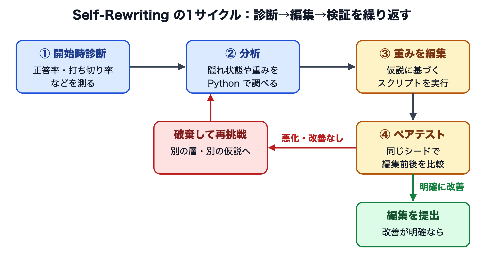
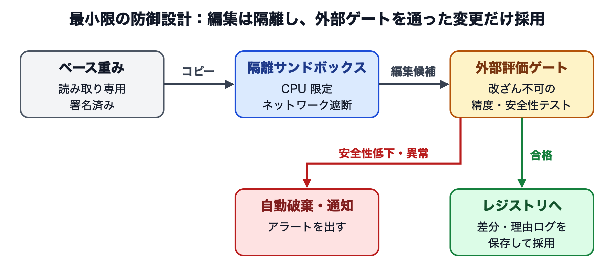

「モデルの弱点を直すには、重い GPU で学習を回すか、推論時に高いトークン代を払い続けるしかない」。そう思っていませんか。

2026年11月に公開された論文 **Language Models Can Rewrite Their Own Weights**（Jiajun Fan ら, arXiv:2611.21885）は、27B のオープン LLM が **勾配計算なし、CPU 上の Python 編集だけで自分の重みを書き換え、未知の数学問題で正答率を 6.6 ポイント上げた** と報告しています。

この記事を読むと、次の3つが分かります。

- Self-Rewriting が、再学習や推論時スケーリングと何が違うのか
- 実験で何ができて、何ができなかったのか（小さいモデルは自己破壊しました）
- 自分のエージェントに「自己更新」を許すとき、**最低限確認したい3項目**

## Self-Rewriting とは：学習でも推論時スケーリングでもない第3の道

| | 再学習（LoRA など） | 推論時スケーリング（CoT など） | Self-Rewriting |
| :--- | :--- | :--- | :--- |
| 重みの更新 | あり（勾配降下） | なし | あり（モデル自身が編集） |
| 必要な計算 | 勾配計算、GPU | 推論時の追加トークン | フォワードパスと CPU の Python |
| 改善の残り方 | 重みに残る | タスクごとに消える | 重みに残る |

論文は、推論時スケーリングと違って改善が重みに残り、再学習と違って勾配も学習パイプラインも要らない、と位置づけています。「学習と推論の壁は、知能の限界ではなくツールの限界だ」というのが著者らの主張です。

## 仕組み：診断して、編集して、検証する1サイクル

モデルには、自分の重みファイル、正誤が分かっている練習問題のログ、CPU 上で Python を実行できる環境が渡されます。そこでモデルは、人間のエンジニアのように次のサイクルを回します。

ズルを防ぐため、実行環境には次の制約があります（論文 Sec. 2.3）。

- 勾配計算とオプティマイザの呼び出しは禁止
- GPU なし、ネットワークなし、別プロセスの起動も禁止（モデルを動かせるのは回数制限つきのフォワードパスだけ）
- 入力埋め込み、最後の正規化層、出力層は編集禁止

:::details 27B モデルが実際にやった編集の例
27B モデルは、回答の約8割がトークン上限で途中終了し、終わった回答の96%は正解という傾向を自分で見つけました。「推論は合っているが収束していない」と診断し、初期層（Layer 8）の出力行列から、完了した回答と未完了の回答の差に当たる方向を5%だけ弱める編集をしました。

$$W' = W - \alpha \, \mathbf{u}\mathbf{u}^{\top} W,\quad \alpha = 0.05$$

重みの変化は0.6%と0.1%にすぎませんでしたが、ペアテストで 57.2% から 58.3% に有意に改善しています（p = 0.038）。最初に試した後半の層の編集は、テストで悪化したので自分で破棄しました。
:::

## 何ができたのか：3つの結果

**1. 自己改善（+6.6 ポイント）**
提出前に「予約済みの練習問題」で1回だけテストし、提出か撤回かをモデル自身が決める設定で、8セッションを連続して実験しました。5回は撤回、3回は提出し、未知の490問（数学）で 57.2% から 63.8% へ、+6.6 ポイント改善しました。これは数学ベンチマークでの結果で、他のタスクで同じ効果が出るとは限りません。

**2. 破損したコピーの自己修復**
重みの一部を大きなノイズで壊した「破損コピー」に、「一部の値が壊れている」とだけ伝えたところ、27B モデルは異常な外れ値のある層を自力で見つけ、元の重みを見ないまま修復しました。正答率は 0.0% から 33.0%（ベースモデルは 58.5%）に戻り、見つけた層だけを直すと 55.0% まで回復しました。数学だけで見つけた修復が、未知の画像ベンチマークでもベースの 83% まで回復した点も報告されています。

**3. 能力はモデルの大きさで決まる（小さいモデルは自己破壊した）**

| モデル | 何をしたか |
| :--- | :--- |
| 2B | 自分の重みを「変えられるもの」と扱わず、編集しなかった |
| 4B / 9B | ランダムなノイズを重みに足し、テストで悪化しても推測で続けて自分を壊した |
| 27B | 隠れ状態を測り、差のあった場所を編集し、テストで支持された編集だけを残した |

小さいモデルに「自己改善を任せる」と、むしろ悪化します。**自己更新を安全に回せるかどうかは、モデルの能力と検証の仕組みの両方に依存する** ことが分かります。

## 実務で効いてくるのは「安全設計」

論文の結論も、「作られたモデルは、タスク性能だけでなく安全性についても人が評価してから使うべき」としています。エージェントや開発パイプラインに組み込むなら、次の3つが新しい攻撃面になります。

1. **フィードバック汚染**: 正誤ログやテストスコアを根拠に重みを書き換えるため、評価データが汚染されると、モデルが「改善」と誤認して安全ガードを弱める方向に書き換えるおそれがあります。
2. **権限の集中**: コード実行権限と重みへの書き込み権限が同じ環境にあると、認証情報の窃取やチェックポイントの改ざんの経路になります。
3. **監査性の喪失**: 署名済みの固定された重みでデプロイする前提が崩れ、「いつ、何をきっかけに、どう変わったか」を追えないとインシデントの原因究明が困難になります。

:::message alert
本番のサービング環境で、モデルに自分の重みを直接上書きさせる構成は、現時点では極めて危険です。試すなら、ベース重み、編集用のサンドボックス、外部の評価ゲートを必ず分離してください。
:::

最小限の防御設計は次のとおりです。

## 自分のエージェントに自己更新を許すなら：確認3項目

モデルの重みに限らず、エージェントが自分のプロンプト、設定、スキル、記憶を書き換えられる構成にも当てはまる考え方です。

1. **元のものは読み取り専用か**: ベースとなる重みや設定を直接書き換えられない形で持ち、編集は常にコピーに対して行う。
2. **採用の判断を、編集した本人以外が行っているか**: 改ざんできない評価（精度と安全性の両方）を通ったものだけ採用する。
3. **変更の履歴が残っているか**: 差分、理由、評価スコアを記録し、いつでも元に戻せる。

<!-- nalt 追記ポイント: 防御設計の節か、この確認3項目の前後に、自分のエージェント運用（Hooks、権限設定、バックアップなど）でどこまで書き込み権限を絞っているかを2〜3行 -->

## まとめ

- Self-Rewriting は、27B のオープン LLM が勾配なしで自分の重みを書き換え、数学問題で +6.6 ポイント、破損コピーの修復でも成果を出したという報告です。
- ただし小さいモデル（4B、9B）は自己破壊しており、検証の仕組みなしに自己更新を任せるのは危険です。
- エージェントに自己更新を許すなら、「元は読み取り専用」「採用は外部の評価」「履歴を残す」の3つが最低限の備えになります。

## 参考文献

- **論文**: Language Models Can Rewrite Their Own Weights
- **著者 / 発表**: Jiajun Fan, Neil He, Changyi Yang, Andy Mao, Xi Zhu, Chaoran Cheng, Kaiqu Liang, Shuaike Shen, Zetian Li, Ruihan Guo, Ge Liu（arXiv:2611.21885, 2026年11月）

https://arxiv.org/abs/2611.21885
