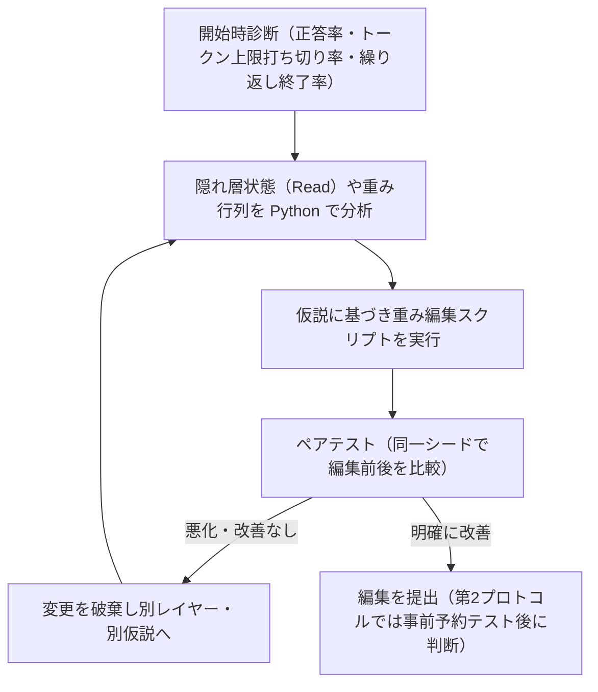

「モデルの弱点を直すには、重い GPU で勾配を回すか、推論時に高いトークン代を払い続けるしかない」――そう思い込んでいませんか？

実は **「学習と推論の壁」は知能の制約ではなくツールの制約にすぎず、27B のオープン LLM が勾配計算ゼロ・推論のみ（CPU 上の Python 編集）で自分の重みを書き換えて +6.6 ポイント賢くなる** ことが実証されました（Jiajun Fan ら, arXiv:2611.21885, 2026年11月）。

:::message
**tl;dr;**
- **何が起きたか**: 27B モデル（Qwen3.5 系）が自身の隠れ層状態を診断し、$W' = W - \alpha \, \mathbf{u}\mathbf{u}^{\top}W$ などの自己編集で未知の数学問題を **57.2% → 63.8%** へ改善。破損したコピーも画像タスクで元精度の **83%** まで自己修復した。
- **どこが危ないか**: 「推論環境から重みを書き換えられる」構造は、フィードバック汚染による自己アライメント崩壊という新たな攻撃面を生む。後半では隔離サンドボックスと独立評価ゲートの設計まで踏み込む。
:::

## 従来の改善手法との違い：学習と推論の壁を越える「第3の道」

従来のモデル改善手法と、論文が提案する Self-Rewriting の違いを整理すると次のようになります。

| 比較軸 | 再学習 / ファインチューニング（LoRA 等） | 推論時スケーリング（CoT / ハーネス等） | Self-Rewriting（本論文） |
| :--- | :--- | :--- | :--- |
| **重みの更新** | あり（勾配降下法・逆伝播） | なし（重みは凍結） | **あり（モデル自身の推論と Python 編集）** |
| **必要な計算** | 勾配計算・オプティマイザ状態 | 推論時の追加トークン・複数回呼び出し | **フォワードパスと CPU 上の Python 編集のみ** |
| **推論時のコスト増** | なし | あり（問題ごとに毎回コスト発生） | **なし（改善が重みに永続化される）** |
| **主なボトルネック** | GPU メモリ・学習パイプライン | レイテンシ・API/推論コスト | **モデルのメタ認知・検証ゲートの設計** |

:::message
論文の核心は、**「学習フェーズと推論フェーズの壁は、知能の本質的な制約ではなくツールの制約にすぎない」**という点にあります。Test-time Scaling のようにタスク終了後に消える一時的な工夫ではなく、フォワードパスだけで得た知見を重みに直接焼き込むため、1問あたりの推論コストを増やさずにモデルを恒久的に改善できます。
:::

## Self-Rewriting の仕組みを噛み砕く

では、勾配降下法なしでどうやって正しい重みの変更方向を見つけるのでしょうか。論文の実験設定では、モデル（Qwen3.5 2B / 4B / 9B / 27B、Gated DeltaNet 線形アテンションと通常の Full Attention のハイブリッド構成）に対して以下の3つを与えます。

1. **自身の重みファイルへのアクセス権**
2. **正誤判定済みの過去の練習問題ログ**（DeepScaleR からベンチマーク重複を除外した 3,000 問のプール）
3. **1 ターン 1 アクションで操作できる実行環境**（1 セッションあたり最大 $B=20$ 回のフォワードパス、$C=200$ 回の CPU 上 Python コード実行）

モデルは「自分自身のオプティマイザ」として振る舞い、次のサイクルを回します。



### 論文で設けられた厳格な制約（Sec. 2.3）

「ズルをして勾配計算や外部アクセスをしない」ことを担保するため、実行環境には以下の制約が課されています。

- **勾配・学習の禁止**: 勾配計算やオプティマイザの呼び出しはすべてブロック。
- **CPU 限定・外部隔離**: Python セッションに GPU はなく、モデルの直接ロード・別プロセス起動・ネットワーク通信は禁止（モデル実行はカウントされた $B=20$ 回のフォワードパスのみ）。
- **編集禁止レイヤーとスケーリング禁止**: 入力埋め込み（Input Embedding）、最後の正規化層（Last Normalisation）、出力層（Output Layer）の編集、およびサンプリング温度の変更と等価になるテンソル全体のスケーリングは拒否。

### 27B モデルはどうやって「自分の重み」を改善したのか

論文（Sec. 3.3, Fig. 13）によると、27B モデルは第1プロトコル（モデル自身の判断で提出を決める設定）において、人間がシステムをデバッグするかのように自己診断を行いました。

1. **症状の特定**: 開始時診断（4,096 トークン予算）で「回答の **80.5%** がトークン上限に達して未完了だが、完了した回答の **96%** は正解」という傾向を把握し、「推論自体は正しいが、結論に収束せず冗長になりすぎている」と診断しました。
2. **初期仮説の失敗と軌道修正**: 最初は完了・未完了の差が大きい後半の Layer 56 で編集を試みましたが、ペアテストで悪化（wrong→right 1問に対し right→wrong 6問）したため即座に破棄しました。
3. **初期層への着目と方向除去**: 「差異は層が深くなるにつれて増幅されるため、原因は初期層にあるはず」と推論し、**Layer 8** に移動。完了した 20 問とトークン上限に達した 20 問の隠れ状態の平均差分から単位方向 $\mathbf{u}$ を求め、Layer 8 の 2 つの出力行列（Attention と MLP）からその方向成分を $\alpha = 0.05$（5%）だけ除去しました。

論文で用意されたヘルパー関数 `remove_direction(W, u, alpha)` は、出力行列 $W$ が隠れ状態（Residual Stream）へ書き込む成分のうち、単位方向 $\mathbf{u}$ に沿う成分を割合 $\alpha$ だけ弱める次の演算を行います。

$$W' = W - \alpha \, \mathbf{u} \mathbf{u}^{\top} W$$

この編集による重みノルムの変化はわずか **0.6% と 0.1%** にすぎませんが、ペアテスト（490 問 × 8 回答、16,384 トークン予算）で **57.2% → 58.3%（+1.1 ポイント、$p = 0.038$）** の有意な精度向上を達成しました。

:::details 論文のアルゴリズムを抽象化した制御ループのイメージ
```python:self_rewrite_loop.py
# 論文 Sec. 2.2 / Alg. 1 のセッション構造を説明するための概念的な疑似コード
def self_rewrite_session(base_weights, graded_logs, max_passes=20, max_code_runs=200):
    current_edit = None
    passes_used = 0

    for turn in range(max_code_runs):
        # 1. モデルが過去の失敗ログ・隠れ状態（Read）・重み行列を分析し、1アクションを選択
        action = model_propose_action(base_weights, graded_logs, current_edit)

        if action.type == "code":
            # CPU 上の Python サンドボックスで W - alpha * (u @ u.T @ W) 等の編集を適用
            current_edit = execute_cpu_python(base_weights, action.script)
        elif action.type == "paired_test" and passes_used < max_passes:
            # 2. 同一シードで編集前後を比較するペアテスト（フォワードパス消費）
            passes_used += 1
            result = run_paired_test(base_weights, current_edit, action.problems)
            if not result.improved:
                current_edit = revert_or_keep_previous()
        elif action.type == "submit":
            break

    return current_edit
```
:::

## 主な実験結果と「スケールによる創発」

論文（arXiv:2611.21885）では、さらに踏み込んだ 2 つの驚くべき結果が報告されています。

### 1. 第2プロトコルでの連続改善（57.2% → 63.8%、+6.6 ポイント）

提出前に「セッションからは読めない予約済み練習問題」で 1 回だけテストを行い、モデル自身が提出または撤回を決める第2プロトコルで 8 セッション連続の実験が行われました（各セッションはベース重みから開始し、提出された編集が「使用中のモデル」を置き換える方式）。

- 8 セッションのうち 5 回（セッション 3〜7）はモデル自身が改善不十分と判断して**撤回**し、残り 3 回を提出。
- 490 問の未知の保持テスト（16,384 トークン予算）において、セッション 2 で **+4.0 ポイント（61.3%）**、セッション 8 で **+6.6 ポイント（57.2% → 63.8%、$p < 10^{-5}$）** まで単調に精度が向上しました。
- 16,384 トークンの上限で打ち切られる回答の割合も、**33.6%（ベース）→ 28.8%（セッション 2）→ 26.1%（セッション 8）** へと減少しています。
- なお、最大の向上をもたらしたセッション 8 の編集は、**全 linear-attention 層の time-step bias を一様に +0.5 引き上げる**という極めてシンプルな変更でした。

### 2. 破損した自身のコピーを直す「自己修復（Self-Repair）」と画像タスクへの転移

全 64 層のうち **Layer 30 の MLP 出力行列（`down_proj`）の連続する 8 行**を大きなガウスノイズ（$\lambda = 200$ 倍の標準偏差）で上書きし、ほとんど問題を解けなくした「破損コピー」をモデルに渡し、「一部の値が破損している」とだけ伝えて修復させる実験も行われました。

- **原因の自力特定**: 27B モデルは「層が進むごとに活性化が爆発している（Layer 0 の ~0.5 → Layer 63 の ~225）」ことを観察した後、全層の出力行列をスキャンして **Layer 30 の `down_proj` に中央値の 1,397 倍（1397×）の極端な外れ値がある** ことを突き止めました。
- **修復と元の重み不要**: 元の正常な重みを一切見せないまま、Layer 30 の `down_proj` と Layers 0–10 の計 20 個の出力行列について「中央値の 15 倍を超える値のみを `15× median` にクリッピングする」（変更したのは重み全体のわずか **0.013%**）という修復を実行。保持データ 200 問で **0.0% → 33.0%**（ベースモデル 58.5%）、さらにモデルが特定した **Layer 30 の `down_proj` 単独**に適用すると **55.0%** まで回復しました。
- **未知の画像タスクへの転移**: テキストの数学問題だけで見つけたこの修復を、学習なしで 6 つの画像ベンチマーク（MathVista, MathVerse, MMStar, HallusionBench, POPE, ScreenSpot-v2）に適用したところ、**7.3% → 70.2%**（ベースモデル 84.3% の **83%**、破損状態の **9.6 倍**）まで回復しました。

### 3. 能力はスケールによって創発する（2B / 4B / 9B vs 27B）

同一モデルファミリー（Qwen3.5）の 4 サイズに同じタスクとツールを与えた結果、明確なスケールの壁が確認されました。

| モデルサイズ | 到達したステップ | 保持テスト（200〜490問）での結果 | 自己修復の結果 |
| :--- | :--- | :--- | :--- |
| **2B** | Python コードの多くが失敗（10%のみ成功）、編集せず | 編集なし | 編集なし（0.0%） |
| **4B** | コード・テストは動くがランダムノイズを加え、全編集を撤回 | テスト上で 44.1% → 0.0%（撤回） | 0.0% → 0.0% |
| **9B** | ランダムノイズ等を加え、テストで悪化した編集をそのまま提出 | **47.5% → 0.0%**（自己破壊） | 0.0% → 0.0% |
| **27B** | 隠れ状態を測定し、ペアテストで悪化した編集を撤回・改善のみ採用 | **57.2% → 58.3%**（第2プロトコルで **63.8%**） | **0.0% → 33.0%**（名指し層単独で **55.0%**） |

## AI × セキュリティ視点：推論時に「重みを書き換えられる」運用リスク

論文の Conclusion でも著者が指摘している通り、Self-Rewriting は「再帰的自己改善（Recursive Self-Improvement）」への道を開く一方で、**「人がループに入り（Human-in-the-loop）、生成されたモデルをタスク性能だけでなく安全性についても評価し、使用前に確認すべきである」** という重大な課題を伴います。

これを実際のサービスや開発パイプラインに組み込む視点で整理すると、従来の MLOps にはなかった **3 つの攻撃面（Attack Surface）** が浮かび上がります。

### 1. フィードバック汚染による「自己アライメント崩壊」

Self-Rewriting は「過去の正誤ログ」や「ペアテストのスコア」を根拠に重みを書き換えます。もし攻撃者が間接プロンプトインジェクションや評価データの汚染を通じて、誤った判定ログや悪意ある指示を混入させた場合、**モデル自身が「性能改善」と誤認して安全ガードレールを弱める方向へ重みを書き換えてしまう**リスクがあります。

### 2. 重みファイルと Python 実行環境の共有による権限リスク

論文では厳格に CPU・ネットワーク遮断・一部レイヤー編集禁止のサンドボックスを設けていましたが、実運用でこれが緩めば「エージェントにコード実行権限とモデル重みへの書き込み権限を同時に渡す」ことになり、ホスト環境の認証情報窃取やチェックポイント改ざんの経路になり得ます。

### 3. モデルの監査性・再現性（Immutable Artifact）の喪失

従来の本番運用では「検証済み・署名済みのモデル重み（Immutable Artifact）」を固定してデプロイすることで、再現性とセキュリティ監査を担保してきました。推論環境で動的に重みが更新される場合、「どの時点の重みがどの入力をきっかけにどう変わったか」を追跡できなければ、インシデント時の原因究明が困難になります。

:::message alert
本番サービング環境でモデルに自身の重みを直接上書きさせる構成は現時点では極めて危険です。実験・検証を行う場合でも、必ず「読み取り専用のベース重み」「隔離された編集サンドボックス」「独立した外部評価ゲート」を分離してください。
:::

### 実運用を見据えた最小限の防御設計


- **検証ゲートの分離**: モデル自身が使う練習問題だけでなく、モデルから隔離された「安全性・アライメント回帰テスト」を外部ゲートとして必ず通す。
- **実行環境の徹底隔離**: 論文の制約と同様、重み編集用の Python サンドボックスはネットワーク通信や別プロセス起動を遮断し、書き込み先を一時領域に限定する。
- **変更の完全な監査ログ**: 論文が「変更はモデルが書いたコードであるため、コミットのように読んで比較・ロールバックできる」と述べている利点を活かし、更新された重みのハッシュ値・編集スクリプト・評価スコア差分を必ず記録する。

## まとめ

- **Language Models Can Rewrite Their Own Weights（arXiv:2611.21885）** は、27B のオープン LLM（Qwen3.5 系）が勾配降下法や再学習なしで、自身の隠れ状態診断と CPU 上の Python 編集によって重みを直接書き換えられることを実証しました。
- 未知の数学問題で +6.6 ポイントの精度向上（57.2% → 63.8%）や、破損した自身のコピーを画像タスクでも元精度の 83% へ戻す自己修復を達成した一方、この能力は 27B 以上のスケールで創発することも示されました。
- 今後のエージェントや継続学習の設計においては、モデルが自己の重みを改変できることによるフィードバック汚染・アライメント崩壊を防ぐため、**隔離サンドボックスと独立した安全性評価ゲート（Human-in-the-loop）** の設計が不可欠になります。

## 参考文献

- **論文タイトル**: Language Models Can Rewrite Their Own Weights
- **著者 / 発表**: Jiajun Fan, Neil He, Changyi Yang, Andy Mao, Xi Zhu, Chaoran Cheng, Kaiqu Liang, Shuaike Shen, Zetian Li, Ruihan Guo, Ge Liu（arXiv:2611.21885, 2026年11月）

https://arxiv.org/abs/2611.21885

https://arxiv.org/pdf/2611.21885
