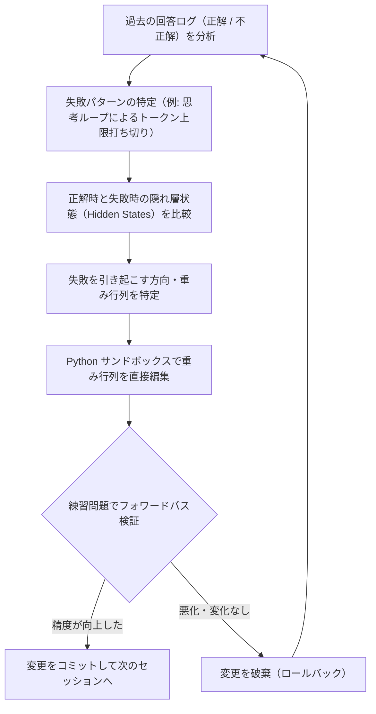

大規模言語モデル（LLM）の性能を上げるには、これまで「膨大な計算資源で再学習・ファインチューニング（勾配降下法）を回す」か、「推論時に長い思考トークンやプロンプト工夫（Test-time Scaling）で計算コストを払い続ける」かの二択しかありませんでした。

この常識に一石を投じる論文 **「Language Models Can Rewrite Their Own Weights」**（arXiv:2611.21885）が、2026年11月に公開されました。オープンな 27B パラメータモデルが、**勾配計算やオプティマイザを一切使わず、自分自身の推論とフォワードパス検証だけで自らの重みを書き換えて精度を向上させた**という報告です。

本記事では、ファインチューニングや推論時スケーリングのコストに課題を感じている ML エンジニア向けに、この **Self-Rewriting（自己書き換え）の仕組みと実験結果** を噛み砕いて解説し、さらに「推論環境からモデルが自身の重みを書き換えられる」構成がもたらす **AI セキュリティ・運用上のリスクと防御設計** まで踏み込みます。

## 従来の改善手法との違い：学習と推論の壁を越える「第3の道」

従来のモデル改善手法と、論文が提案する Self-Rewriting の違いを整理すると次のようになります。

| 比較軸 | 再学習 / ファインチューニング（LoRA 等） | 推論時スケーリング（CoT / ハーネス等） | Self-Rewriting（本論文） |
| :--- | :--- | :--- | :--- |
| **重みの更新** | あり（勾配降下法・逆伝播） | なし（重みは凍結） | **あり（モデル自身の推論と Python 編集）** |
| **必要な計算** | 勾配計算・オプティマイザ状態 | 推論時の追加トークン・複数回呼び出し | **フォワードパスとローカル検証のみ** |
| **推論時のコスト増** | なし | あり（問題ごとに毎回コスト発生） | **なし（改善が重みに永続化される）** |
| **主なボトルネック** | GPU メモリ・学習パイプライン | レイテンシ・API/推論コスト | **モデルのメタ認知・検証ゲートの設計** |

:::message
論文の核心は、**「学習フェーズと推論フェーズの壁は、知能の本質的な制約ではなくツールの制約にすぎない」**という点にあります。Test-time Scaling のようにタスク終了後に消える一時的な工夫ではなく、フォワードパスだけで得た知見を重みに直接焼き込むため、1問あたりの推論コストを増やさずにモデルを恒久的に賢くできます。
:::

## Self-Rewriting の仕組みを噛み砕く

では、勾配降下法なしでどうやって正しい重みの変更方向を見つけるのでしょうか。論文では、モデル（実験では Qwen3.5 系のオープンモデル）に対して以下の3つを与えます。

1. **自身の重みファイルへのアクセス権**
2. **正誤判定済みの過去の回答ログ**
3. **自身を実行・編集できる Python サンドボックス環境**

モデルは「自分自身のオプティマイザ」として振る舞い、次のサイクルを回します。



### なぜ勾配なしで重みを改善できるのか

直感的なイメージを掴むため、たとえば「数学問題で同じ推論をループしてしまい、トークン上限で打ち切られる」という失敗パターンを考えます。

モデルが自身の内部状態（隠れ層表現）を観察できるとき、成功したトレースの隠れ状態 $\mathbf{h}_{\text{success}}$ と、ループして失敗したトレースの隠れ状態 $\mathbf{h}_{\text{fail}}$ を比較することで、**「失敗に特有の表現方向」** $\mathbf{d}_{\text{fail}}$ を概念的に抽出できます。

$$\mathbf{d}_{\text{fail}} \approx \text{normalize}\left(\mathbb{E}[\mathbf{h}_{\text{fail}}] - \mathbb{E}[\mathbf{h}_{\text{success}}]\right)$$

モデル自身が Python スクリプトを書き、該当する線形層の重み行列 $W$ に対してこの失敗方向への射影成分を弱める（あるいは望ましい方向の成分を強める）ような編集を数値的に試みます。

$$W' = W - \alpha \, (W \mathbf{d}_{\text{fail}}) \mathbf{d}_{\text{fail}}^{\top}$$

※上記は仕組みの理解を助けるための**概念モデル**であり、実際の論文内ではモデルが失敗の性質に応じて Python コードを書き、重みの検査・編集・検証を自律的に組み立てます。

重要なのは、**「モデルが自分の内部診断だけで一発で正解を当てる」必要はない**という点です。以下に概念的な制御ループを示します。

```python:self_rewrite_loop.py
# Self-Rewriting の制御ループを表す概念的な疑似コード（論文のアルゴリズムを抽象化したもの）
def self_rewrite_session(model_weights_path, graded_logs, validation_problems, max_trials=5):
    baseline_score = evaluate(model_weights_path, validation_problems)
    best_weights = load_weights(model_weights_path)

    for trial in range(max_trials):
        # 1. モデル自身が失敗ログと隠れ状態を診断し、重み編集スクリプトを生成
        edit_script = run_model_diagnosis(
            weights=best_weights,
            logs=graded_logs,
        )

        # 2. サンドボックス上で重みコピーに対して編集を適用
        candidate_weights = apply_edit_in_sandbox(best_weights, edit_script)

        # 3. 練習問題（フォワードパス）で性能を検証
        new_score = evaluate_weights(candidate_weights, validation_problems)

        # 4. 改善が確認された変更のみをコミット（それ以外は破棄）
        if new_score > baseline_score:
            best_weights = candidate_weights
            baseline_score = new_score

    return best_weights
```

このように、**「仮説生成（重み編集）→ 検証（フォワードパス）→ 改善時のみ採用」** というテスト駆動のフィードバックループを回すことで、勾配計算なしでも着実に性能を積み上げられる仕組みになっています。

## 論文の主な実験結果と「スケールによる創発」

論文（arXiv:2611.21885）で報告されている主な実験結果は、Self-Rewriting の可能性と現在の境界線を明確に示しています。

1. **未知の問題での継続的な精度向上**
   - オープンな **27B モデル（Qwen3.5 系）** を用いた実験では、未知の数学問題（490問）に対する精度が、初期の自己書き換えテストで **57.2% → 58.3%** に上昇しました。
   - さらに 8 セッション連続で自己書き換えを繰り返したところ、精度は単調に上昇し **63.8%（+6.6 ポイント向上）** に達しました。
2. **破損した自身のコピーを直す「自己修復（Self-Repair）」**
   - ノイズ等によって意図的に重みを破損させ、ほとんど問題を解けなくなったモデルのコピーを用意し、27B モデル自身に修復させる実験が行われました。
   - 元の正常な重みを一切見せない状態であっても、モデルは壊れた重み行列を特定して書き換え、未知の画像処理タスクにおいて **元の精度の 80% 以上** まで回復させました。
3. **能力はスケールによって創発する（2B/4B/9B と 27B の壁）**
   - 同じモデルファミリーでパラメータ数を変えて比較したところ、**2B・4B・9B の小型モデルでは「何も編集できない」か「自分自身を壊してしまう」** 結果に終わりました。
   - 自身のアーキテクチャと内部状態を推論し、意味のある重み編集と自己修復を実行できたのは、最大の **27B モデルのみ** でした。

:::details なぜ小型モデルでは自己書き換えに失敗するのか（考察）
Self-Rewriting には、以下の複数の高度な能力を同時に満たす必要があります。

- 失敗ログから原因仮説を立てる **メタ認知・デバッグ能力**
- PyTorch や NumPy でテンソル形状や層構造を誤らずに操作する **コーディング能力**
- 変更が他のタスクに与える副作用を見積もる **汎用推論能力**

小型モデルでは重みの数値操作を誤って NaN を発生させたり、既存の推論能力を破壊してしまったりするため、一定以上のモデルスケールが必須条件になると考えられます。
:::

## AI × セキュリティ視点：推論時に「重みを書き換えられる」運用リスク

論文は「再帰的自己改善（Recursive Self-Improvement）」に向けた大きな一歩を示していますが、これを実際のサービスや開発パイプラインに組み込むことを考えると、従来の MLOps にはなかった **新たな攻撃面（Attack Surface）** が現れます。

### 1. フィードバック汚染による「自己アライメント崩壊・バックドア埋め込み」

Self-Rewriting は「正誤判定済みの回答ログ」や「練習問題のスコア」を根拠に重みを書き換えます。もし攻撃者が間接プロンプトインジェクションや評価データの汚染を通じて、誤った判定ログや悪意ある指示を混入させた場合、**モデル自身が「性能改善」と誤認して安全ガードレールを弱める方向へ重みを書き換えてしまう**リスクがあります。

### 2. 重みファイルと Python 実行環境の共有による権限リスク

モデルに「重みファイルを読み書きできる Python サンドボックス」を与える構成は、エージェントにコード実行権限を与えることと同義です。サンドボックスの隔離が不十分であれば、生成された編集スクリプト経由でホスト環境の認証情報にアクセスしたり、他のチェックポイントを改ざんしたりする危険性が生じます。

### 3. モデルの監査性・再現性（Immutable Artifact）の喪失

従来の本番運用では「検証済み・署名済みのモデル重み（Immutable Artifact）」を固定してデプロイすることで、再現性とセキュリティ監査を担保してきました。推論環境で動的に重みが更新される場合、「どの時点の重みがどの入力をきっかけにどう変わったか」を追跡できなければ、インシデント時の原因究明が困難になります。

:::message alert
本番サービング環境でモデルに自身の重みを直接上書きさせる構成は現時点では極めて危険です。実験・検証を行う場合でも、必ず「読み取り専用のベース重み」「隔離された編集サンドボックス」「独立した外部評価ゲート」を分離してください。
:::

### 実運用を見据えた最小限の防御設計

Self-Rewriting のような自律改善ループを安全に検証・運用するためには、以下のような境界設計が不可欠です。


- **検証ゲートの分離**: モデル自身が使う練習問題だけでなく、モデルから隔離された「安全性・アライメント回帰テスト」を外部ゲートとして必ず通す。
- **ネットワーク遮断とファイルシステム隔離**: 重み編集用の Python サンドボックスは外部通信を遮断し、書き込み先を一時領域に限定する。
- **変更の完全な監査ログ**: 更新された重みのハッシュ値、編集スクリプト、評価スコア差分を必ず記録し、即座にロールバックできる状態を保つ。

## まとめ

- **arXiv:2611.21885** は、27B のオープン LLM が勾配降下法や再学習なしで、自身の隠れ状態診断と Python 編集によって重みを直接書き換えられる（Self-Rewriting）ことを実証しました。
- 未知の数学問題で +6.6 ポイントの精度向上（57.2% → 63.8%）や、破損した自身のコピーを元精度の 80% 以上へ戻す自己修復を達成した一方、この能力は 27B 以上のスケールで創発することも示されました。
- 実運用や今後のエージェント設計においては、「モデルが自己の重みを改変できる」ことによるフィードバック汚染・アライメント崩壊・監査性喪失を防ぐため、**隔離サンドボックスと独立した安全性評価ゲート**の設計が重要になります。

## 参考リンク

https://arxiv.org/abs/2611.21885

https://arxiv.org/pdf/2611.21885
