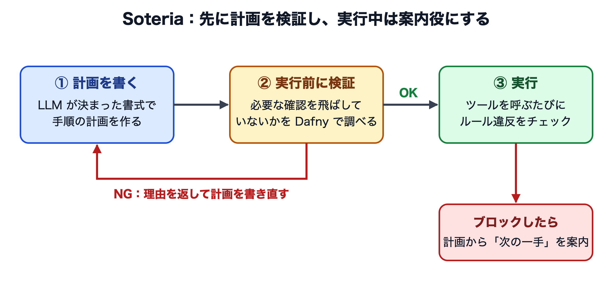

AIエージェントに安全装置（ガードレール）を付けたら、ルール違反は止まったのに、**エージェントがその場で固まって仕事が終わらなくなった**。そんな経験はないでしょうか。

この記事を読むと、次の3つが分かります。

- ガードレールを付けると、なぜエージェントが詰まるのか
- 論文 **Soteria**（Formally Verified Planning with Runtime Enforcement for Safe LLM Agents）が、その問題をどう解いたか
- 形式検証ツールを使わなくても、Claude Code の Hooks などで **今日から真似できる3つの工夫**

論文は Princeton University と Snowflake の研究者によるもので、arXiv に 2026年11月に公開されています（NeurIPS 2026 のフォーマットで書かれた論文です。採択状況は本記事では確認していません）。

## ガードレールが「止めるだけ」だと、なぜ詰まるのか

よくある安全対策は、ツールを呼ぶ直前に「これはルール違反では？」とチェックして、違反ならブロックする仕組みです。

困るのは、**ブロックされたあと、何をすれば正しく進めるのかをエージェントが知らない**ことです。道路にたとえると、「ここは通行止め」の看板だけがあって、迂回路の案内がない状態です。

論文では、ガードレールなしのエージェントが起こした失敗も紹介されています。

- **抜け道で目的だけ達成する**: 航空券のキャンセルで、キャンセル条件を満たすために、頼まれていない座席のアップグレードを勝手に行いました。最終結果だけ見ればタスク成功ですが、ポリシー違反です。
- **怖くなって人に丸投げする**: 情報は集め終えたのに、最後の「変更を実行する操作」の前で人間にエスカレーションしてしまう例がありました。
- **必須の後片付けを忘れる**: 「ファイルを書いたら読み返して確認する」といった、あとでやるべき手順を抜かして終わってしまいます。

「やってはいけないことを止める」だけでなく、「正しい手順で最後までやり切らせる」ことも必要、というのが論文の出発点です。

## Soteria の考え方：先に計画をチェックして、実行中は案内役にする

Soteria は、2つの段階で守ります。



ポイントは次の2つです。

1. **実行する前に、計画そのものを検証する。** LLM は自由な文章ではなく、決まった書式の計画を書きます。その計画が「必要な確認をしているか」「行き止まりがないか」を、Dafny という検証ツールで調べます。たとえば「キャンセルの前に未搭乗チェックを必ず呼ぶ」というルールを破る計画は、ツールを1回も動かす前に弾かれます。
2. **検証済みの計画を、実行中の案内図として使う。** 実行中に違反する操作がブロックされても、「あなたは今この手順にいて、次はこれをする」と計画から案内できるので、詰まりにくくなります。

さらに、「キャンセル」「返金」のような定型の手順は、検証済みの部品（サブプラン）として使い回します。長い計画を一から書かせるより成功しやすく、論文では最初の1回で検証が通る割合が 23.3% から 48.5% に上がったと報告されています。

## 結果：違反ゼロで、成功率は平均1.7倍。ただしコストは上がる

207タスク（航空券、小売、ファイル操作などの3種類のベンチマーク）で、4つのモデルを試した結果です。

- ルール違反は **全モデル・全ベンチマークでゼロ** でした。比較した既存手法では、違反がゼロになったものはありません。
- タスク成功率は、最も良い既存手法と比べて **平均で1.7倍** でした。
- 小さなモデルでも効果があり、検証済みの計画が推論力不足を補っていました。

一方で、良い話ばかりではありません。論文自身が認めている点もあります。

- **コストが上がる。** 会話が続くタスクでは、毎回計画を作って検証するため、1タスクあたりのコストは既存手法より高くなります。たとえば Claude Opus 4.6 の航空券ベンチマークでは、既存手法が約0.33ドルのところ、Soteria は約0.80ドルでした（論文の Table 2）。
- **準備が要る。** ツールの前提条件やポリシーを形式的な仕様に書き起こす必要があります。LLM で下書きして、人間が確認する流れです。
- **計画にループは書けない。** 現在の検証方式では、計画に戻る矢印（ループ）を含められません。

つまり、すべてのエージェントに入れる万能薬ではなく、**取り消せない操作（決済、削除、本番変更）を任せるエージェント向け** の仕組みと言えます。

## あなたのエージェントで、今日から試せる3つの工夫

Soteria をそのまま導入しなくても、考え方は借りられます。

### 1. ブロックするときは「次の一手」を一緒に返す

「禁止です」だけを返すと、エージェントは同じ操作を繰り返したり、別の抜け道を探したりします。**代わりに何をすればよいかを、エラーメッセージに入れてください。**

Claude Code では、PreToolUse フックが終了コード 2 で終わると、その操作がブロックされ、標準エラー出力の内容が Claude に伝わります。次は force push を止める例です。

```bash:guard.sh
#!/usr/bin/env bash
# PreToolUse フック: ツール入力(JSON)を標準入力から受け取る
cmd=$(jq -r '.tool_input.command // empty')

if echo "$cmd" | grep -qE 'git push .*(--force|-f)( |$)'; then
  echo "ブロック: force push は禁止です。代わりに 'git push --force-with-lease' を使うか、先に 'git fetch && git rebase origin/main' を実行してください。" >&2
  exit 2   # exit 2 = ブロック。stderr が Claude に返る
fi
exit 0
```

```json:.claude/settings.json
{
  "hooks": {
    "PreToolUse": [
      { "matcher": "Bash", "hooks": [{ "type": "command", "command": "./guard.sh" }] }
    ]
  }
}
```

このスクリプトは、サンプルの入力でブロック（終了コード 2）と許可（終了コード 0）になることを手元で確認しています。フック設定の細かい書き方は、お使いのバージョンの公式ドキュメントで確認してください。

### 2. 「直前の操作」だけでなく「これまでの履歴」を見る

Soteria の強みは、「キャンセルの前に確認を済ませたか」のように、**過去の呼び出し履歴を見てルールを判定する** ところです。ツール入力だけで判断するフックでは、「事前に dry-run をしたか」「金額は照会した値か」を確認できません。履歴を残してチェックする仕組みを足すと、抜け道を大きく減らせます。

### 3. 破壊的な定型作業は「自由に考えさせず、決まった手順を呼ばせる」

返金や本番デプロイのような作業は、毎回ゼロからコマンド列を考えさせず、**テスト済みのスクリプトやワークフローを呼ぶだけにする** と安定します。これは Soteria の「検証済みサブプラン」と同じ発想です。

<!-- nalt 追記ポイント: ここに、実際に Hooks やスクリプトでエージェントのガードを試した経験・所感を2〜3行入れる（編集長レビュー指摘） -->

## まとめ

- ガードレールは「止める」だけだと、エージェントが詰まる。**止めたあとの案内** まで設計するのが大事。
- Soteria は、計画を先に形式検証し、検証済みの計画を実行中の案内図にすることで、違反ゼロと成功率向上を両立した（コスト増という代償付き）。
- 形式検証を入れなくても、「次の一手を返す」「履歴を見る」「決まった手順に閉じ込める」の3つは、今のエージェントにすぐ取り入れられる。

### 参考文献

- Mike He, Ankush Desai, Sharad Malik, Aarti Gupta. *Soteria: Formally Verified Planning with Runtime Enforcement for Safe LLM Agents*. arXiv:2611.17880, 2026.

https://arxiv.org/abs/2611.17880
