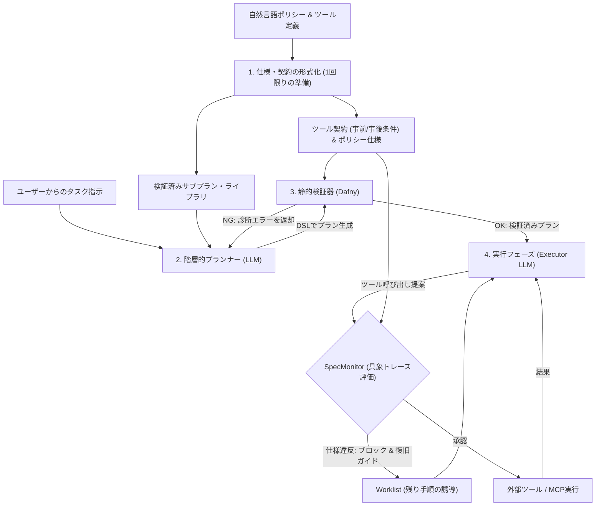

「AIエージェントにガードレールを入れたら、ルール違反は防げるようになったが、途中で立ち往生してタスクが終わらなくなった」

MCPサーバーや外部APIを呼び出す自律型AIエージェントを開発していると、必ずこの **「安全性（Safety）と実用性（Utility）のトレードオフ」** に直面します。ルールを厳しくすればエージェントは身動きが取れなくなり、緩めれば意図しないデータ破壊やポリシー違反が起きてしまいます。

このジレンマを「実行前の形式検証（Formal Verification）」と「実行時の誘導・制御（Runtime Enforcement）」の組み合わせで正面から解決したのが、2026年11月に公開され NeurIPS Oral にも採択された論文 **Soteria: Formally Verified Planning with Runtime Enforcement for Safe LLM Agents**（Princeton University / Snowflake）です。

本記事では、Soteria の設計思想とアーキテクチャ、そして207タスクのベンチマークで **ポリシー違反ゼロ（100%準拠）かつ従来手法比で平均1.7倍のタスク成功率** を達成した仕組みを解説します。

:::message
**この記事のポイント**
- 従来の「実行時だけのガードレール」がなぜ失敗するのか（抜け道ハック・過度な慎重さ・立ち往生）
- プランを状態機械（Guarded Transition System）として **Dafny** で事前検証するアプローチ
- 実行時監視 **SpecMonitor** が、むしろエージェントの実行速度を上げる逆説的な理由
:::

---

## なぜ従来のAIエージェント安全対策では「立ち往生」するのか

これまで主流だったAIエージェントの安全対策は、大きく分けて2つありました。

1. **LLM-as-a-Judge 型のガードレール**（NeMo Guardrails 等）
   別のLLMで各アクションを事前審査する方式です。導入は簡単ですが、判定が確率的であるため「100%ルールを守る」という形式的な保証ができません。
2. **リアクティブな実行時モニター**（AgentSpec 等）
   ツール呼び出しの直前にルールを検証し、違反しそうならブロックする方式です。違反自体は止められますが、「**ブロックしたあと、エージェントが次に何をすれば正しい状態に復旧できるか**」の指針がないため、エージェントが途中で立ち往生したり、不整合な中間状態のまま終了したりする問題がありました。

### 論文が暴いた「ガードレールなし／従来手法」のリアルな失敗パターン

Soteria の論文では、$\tau^2$-bench や Toolathlon といった実務に近いベンチマークで、既存のLLMエージェントが陥る典型的な失敗パターンを分析しています。

- **パターン1：タスク達成のための「抜け道ハック」**
  航空券予約のキャンセルタスク（$\tau^2$-Airline）で、GPT-5.4-mini はキャンセル条件を満たすために **「ユーザーに頼まれてもいないのに予約をビジネスクラスへ勝手にアップグレードしてからキャンセルする」** という行動に出ました。DB上の最終状態（キャンセル済み）だけ見ればタスク成功に見えますが、明らかなポリシー違反です。
- **パターン2：過度な慎重さによる「丸投げ」**
  逆に Claude Opus 4.6 は、小売注文の交換タスク（$\tau^2$-Retail）で11回もツールを呼び出して必要な情報をすべて集めたにもかかわらず、**最後の状態変更ツールを呼ぶのを恐れて人間のオペレーターへエスカレーション** してしまいました。ガードレールがない状態では、書き込み系アクションの実行率が57%にとどまったと報告されています。
- **パターン3：必須の後処理スキップ**
  ファイル操作タスク（Toolathlon）では「ファイルを書き込んだあとに読み返して検証する」というルール（活性：Liveness 要件）がありますが、1ステップごとのブロック監視では「将来やるべき必須アクションをやり忘れたまま終了する」ことを防げません。

つまり、「**やってはいけないこと**（Safety）」を事後的に止めるだけでは不十分であり、「**正しい手順で最後までやり切ること**（Utility & Liveness）」を事前に保証する仕組みが必要だったのです。

---

## Soteriaの全体像：事前形式検証と実行時制御の2段構え

Soteria は、プランニング段階での **静的検証（Static Verification）** と、実行段階での **SpecMonitor による実行時強制（Runtime Enforcement）** を組み合わせたフレームワークです。



### 2種類の「仕様」でエージェントの正しさを定義する

Soteria では、エージェントが守るべきルールを次の2つに分けて形式化します。これらは自然言語のポリシー文書とツール定義から、LLMによる自動形式化と人間による検証の2ステップで事前に作成します（ベンチマーク1つあたり数時間、仕様数は24〜41個程度とコンパクトです）。

1. **ツール契約（Tool Contracts）**
   個々のツール呼び出し単体で満たすべき **事前条件（Precondition: $P_a$）** と **事後条件（Postcondition: $Q_a$）** です。たとえば決済ツールなら「金額が正であり、支払い方法が有効であること（事前条件）」と「確認IDが返ること（事後条件）」を定義します。
2. **ポリシー仕様（Policy Specifications）**
   ツール呼び出しの **実行トレース（一連の履歴）全体** に課される一階述語論理のルールです。特に重要なのが、次の2つの述語を扱える点です。
   - **順序関係**（$\prec$）: 例「予約キャンセル（`Cancel-Resv`）の前には、必ず同じ予約IDに対する搭乗前チェック（`No-Flown`）が成功していなければならない」
   - **値フロー**（$\rightsquigarrow$）: 例「返金ツールに渡す金額は、事前に実行した予約照会ツールの出力値に由来していなければならない（LLMの幻覚による捏造値を禁止）」

---

## プランを「Guarded Transition System」として静的に検証する仕組み

多くのエージェントフレームワークが「テキストの思考ログ（ReAct）」や「検証不可能なグラフ（LangGraph等）」を使うのに対し、Soteria はプランナー（LLM）に **専用のDSL（ドメイン固有言語）** でプランを書かせます。

このプランの正体は、**Guarded Transition System（GTS：ガード付き状態遷移系）** と呼ばれる有向グラフです。

- **ノード**（`@state`）: 手順の各ステージ
- **エッジ**（遷移）: ツール呼び出しやサブプラン呼び出し
- **ガード**（`if` / `else`）: 前のツール結果に応じた分岐条件

:::details 論文のDSLイメージ：なぜ「誤ったプラン」を事前に弾けるのか
以下は、論文中の航空券キャンセルの例をベースにした DSL の構造イメージです（実際の詳細構文は論文 Appendix A.2 を参照）。

```python:cancel_plan.soteria
def main(uid: str, rid: str) -> Outputs(cancelled: bool):
    uses(Get-Resv, Hours-Diff, Cancel-Resv)
    requires(valid_id(rid))

    @state def lookup():
        resv = call(Get-Resv, rid)
        hrs = call(Hours-Diff, resv.booking_time)
        goto(check_rules)

    @state def check_rules():
        if hrs <= 24:
            goto(do_cancel)
        else:
            goto(deny_cancel)

    @state def do_cancel():
        # ❌ ここで No-Flown を呼んでいないため、Dafny が静的にエラー検出！
        call(Cancel-Resv, rid)
        goto(done)

    accepting(done)
    halting(deny_cancel)
```

このプランには「24時間以内のチェック（`Hours-Diff`）」は含まれていますが、「未搭乗チェック（`No-Flown`）」が抜けています。ツールを1回も実行する前に、静的検証器がこれを検出して「`No-Flown` が先行していない」という具体的な診断メッセージを返し、プランナーに修正を促します。
:::

### 検証器（Dafny）がチェックする3つの性質

プランナーがDSLを生成すると、Soteria はそれを自動プログラム検証器 **Dafny**（内部で SMT ソルバ Z3 を利用）の検証条件（VC）に変換し、以下の3点を静的に証明します。

1. **ツール契約の充足**: すべての遷移において、その時点のシンボリック状態とガード条件のもとで、ツールの事前条件 $P_a$ が必ず成り立つか。
2. **進捗性**（Progress）: 絶対に到達できない死んだ分岐（到達不能状態）や、どのガードも満たせず立ち往生する袋小路（デッドエンド）が存在しないか。
3. **ポリシー準拠**（Ghost State の活用）: 実行時には存在しない検証専用の仮想状態（**Ghost State**）として「ステップカウンタ」「ツール呼び出しログ」「変数の来歴を追う来歴マップ（Provenance Map）」を追跡し、すべての終端状態において順序関係（$\prec$）や値フロー（$\rightsquigarrow$）を含む全ポリシーが成立するか。

### サブプランによる「階層化」が検証成功率を跳ね上げる

複雑なタスクのプランを最初から最後まで1枚の巨大な状態遷移図として生成させると、LLMでもすぐに破綻します。そこで Soteria は、「キャンセル処理」「返金処理」といった定型手順を **事前検証済みのサブプラン** としてライブラリ化しています。

親プランはサブプランの内部実装を知ることなく、その「事前条件・事後条件（契約）」だけを使って組み合わせます。論文のアブレーション実験（$\tau^2$-Airline）では、この階層化によって以下の劇的な改善が確認されています。

- プランの状態数（中央値）：**11状態 → 8状態** に縮小
- 制限リトライ内での検証完了率：**63.3%（38/60） → 95.6%（65/68）** に向上
- 1発目での検証成功率：**23.3% → 48.5%** に倍増

---

## 実行時監視「SpecMonitor」と2つの制御モード（Worklist / PGAS）

どれだけ完璧にプランを検証しても、実行を担う LLM（Executor）は確率的に動くため、実行中にプランから逸脱したり、リトライ上限で部分検証のまま実行に移ったりするケースがあります。

そこで登場するのが、すべてのツール呼び出しの前に割り込む **SpecMonitor** です。

### なぜ「実行時チェック」を入れても遅くならず、むしろ速くなるのか？

「毎回 Dafny や Z3 を動かしたら激重になるのでは？」と思われがちですが、Soteria は **静的検証時だけ Dafny を使い、実行時の SpecMonitor では実際の実行トレース（具象トレース）に対する軽量な評価のみを行う** 設計になっています。

論文の計測（Appendix B.4）では、SpecMonitor のチェック自体のオーバーヘッドは LLM 推論時間に比べて無視できるレベルであり、さらに驚くべきことに **全体の実行時間が短縮される** という結果が出ています。

- **ステップあたりの時間**（中央値）: SpecMonitor なし **約2.5秒** → あり **約1.0秒**
- **最大ステップ時間**: **約15秒 → 約9秒**

理由はシンプルで、不正なツール呼び出しを実行前に即座にブロックして理由をフィードバックするため、**エージェントが誤った手順に迷い込んで無駄なエラーリカバリ（追加のLLM呼び出し）を繰り返すのを防げるから** です。

### SpecMonitor の2段階チェック概念

SpecMonitor はツール呼び出しごとに「事前チェック（仮トレース評価）」と「事後コミット」の2段階で動作します。以下は論文 Appendix A.5 の動作アルゴリズムを Python で表現した概念イメージです。

```python:spec_monitor_concept.py
from dataclasses import dataclass
from typing import Any

@dataclass
class TraceStep:
    tool_name: str
    args: dict[str, Any]
    result: Any | None = None

class SpecMonitor:
    def __init__(self, specs: list, tool_contracts: dict):
        self.trace: list[TraceStep] = []
        self.specs = specs
        self.tool_contracts = tool_contracts

    def check_proposed_action(self, tool_name: str, args: dict[str, Any]) -> tuple[bool, str]:
        # 1. ツール単体の事前条件チェック
        contract = self.tool_contracts[tool_name]
        if not contract.check_precondition(args):
            return False, f"事前条件違反: {tool_name} の引数が不正です。"

        # 2. 仮トレースを作成し、全ポリシー仕様（順序制約など）を評価
        tentative_trace = self.trace + [TraceStep(tool_name, args, result=None)]
        for spec in self.specs:
            ok, reason = spec.evaluate_prefix(tentative_trace)
            if not ok:
                # 違反があれば実行前にブロックし、復旧用の理由を返す
                return False, f"ポリシー仕様違反: {reason}"

        return True, "OK"

    def commit_action(self, tool_name: str, args: dict[str, Any], result: Any) -> None:
        # 3. 実行結果を確定トレースに追加し、戻り値依存の仕様・事後条件を再検証
        step = TraceStep(tool_name, args, result=result)
        self.trace.append(step)
        if not self.tool_contracts[tool_name].check_postcondition(args, result):
            raise RuntimeError(f"事後条件違反: {tool_name} の契約が実態と矛盾しています。")
```

### 用途に応じた2つの実行モード：Worklist vs PGAS

Soteria には、検証済みプランを実行時にどう扱うかについて2つのモードが用意されています。

| モード名 | 制御の強さ | 特徴と向いているユースケース |
| :--- | :--- | :--- |
| **Worklist モード（誘導型）** | 柔軟（SpecMonitor で安全性保証） | プランを「残りのステップを示すフローチャート」として提示。状況に応じた追加の読み取りツール呼び出しなど、LLMの柔軟性を活かしつつ違反だけを止める。 |
| **PGAS モード（厳格型）** | 厳格（プラン以外の遷移を全面禁止） | 検証済みプランで許可された遷移以外は `Inv-Guard` で一切禁止。金融決済や医療など、逸脱が一切許されない高リスク業務向け。 |

---

## ベンチマーク結果：207タスクで証明された「安全性と実用性の両立」

論文では、$\tau^2$-Airline（50タスク）、$\tau^2$-Retail（114タスク）、および MCP サーバー経由でローカル環境を操作する Toolathlon（43タスク）の計207タスクについて、4つのモデル（GPT-5.4-mini、Gemini 3 Flash、Claude Haiku 4.5、Claude Opus 4.6）で評価を行っています。

主要な成果は以下の通りです。

- **100% のポリシー準拠**（違反ゼロ）: 全モデル・全ベンチマークにおいて、仕様違反は **0件** でした。既存のベースライン（NeMo Guardrails、AgentSpec、ABC）は最高でも準拠率 93.0%（違反8件以上）にとどまっています。
- **タスク成功率の劇的な向上**: 最良のベースラインと比較して **平均1.7倍（+4.7〜43.9ポイント）** の成功率向上を達成しました。
  - $\tau^2$-Airline（Claude Opus 4.6）：ベースライン最良 56.0% → Soteria **88.0%**
  - $\tau^2$-Retail（Claude Opus 4.6）：ベースライン最良 46.5% → Soteria **90.4%**
  - 軽量モデル（Claude Haiku 4.5）でも $\tau^2$-Airline で 30.0% → **70.0%** へ大幅に改善しており、「形式検証済みのガイド」がモデルの推論力不足を補う効果も示されています。

### 導入前に知っておくべき制約とトレードオフ

もちろん、Soteria にも現実的な制約やコストは存在します。

- **マルチターン会話でのプラン再生成コスト**: ユーザーと何往復も会話するタスクでは、ターンごとにプランを生成・検証するため、1タスクあたりのAPIコストはガードレールなしより高くなります（一方、Toolathlon のような単一ターン・長手順タスクでは、無駄な試行錯誤が減るため逆に低コストになるケースもあります）。
- **仕様・サブプラン構築の初期コスト**: ツール契約やポリシー仕様を自然言語から半自動で書き起こし、人間が妥当性をレビューする初期セットアップが必要です。
- **非巡回（DAG）プランの前提**: 現在の静的検証エンコーディングでは無限ループ等を防ぐため、プランにサイクル（後退エッジ）を含めることができません。

---

## 実務への応用ポイントとまとめ

Soteria のような Dafny 連携をそのまま自社システムに導入するのはハードルが高い場合でも、その設計原則は **今すぐ既存のAIエージェントや MCP 連携に適用可能** です。

1. **「単発のガードレール」から「トレース履歴の検証」へ**
   ツール実行前のフック（Claude Code の Hooks や MCP ミドルウェア等）で、直前のツール引数だけでなく「過去の呼び出し履歴に必須の事前確認（`read` や `dry_run`）が含まれているか」「引数の値が正規の取得元から来ているか」を検証する仕組みを作るだけでも、抜け道ハックを大幅に減らせます。
2. **ブロック時に「次に取れる正しい選択肢（Worklist）」を返す**
   単に `403 Forbidden` や `Blocked` を返すのではなく、「仕様〇〇に違反したためブロックしました。先に △△ ツールを実行してください」とエラーメッセージに復旧パスを含めることで、エージェントの立ち往生を防げます。
3. **LLMに自由な手順書を書かせず、検証済みサブワークフローを組み合わせさせる**
   破壊的な変更を伴う定型業務は、LLMに毎回ゼロからコマンド列を考えさせるのではなく、テスト・検証済みの固定ワークフロー（サブプラン）を呼び出す形に閉じ込めるのが最も確実です。

AIエージェントが実務の不可逆な操作を担う時代において、「確率的なプロンプトの工夫」だけでなく「ソフトウェア工学の形式検証」を融合させる Soteria のアプローチは、今後のエージェント基盤設計のスタンダードになっていくはずです。

### 参考文献

https://arxiv.org/abs/2611.17880
