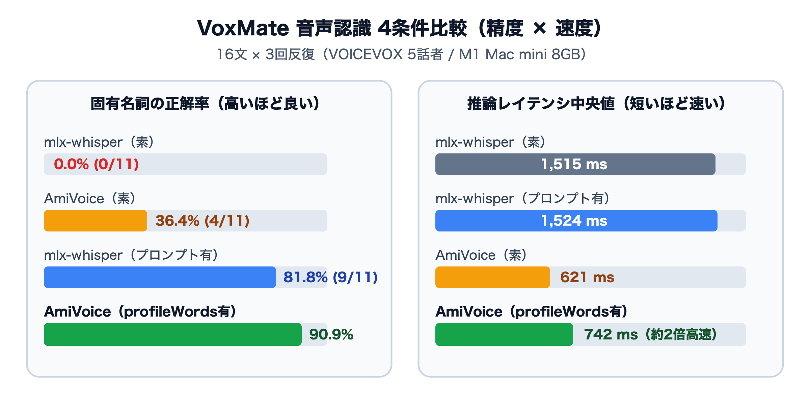

自作の音声アシスタント（[VoxMate](https://github.com/Naruto-Takahashi/voxmate)）を動かしていると、ローカル Whisper が毎回なかなかパンチの効いた空耳を返してきます。

- 「ずんだもん」→「**すんだもん**」（誰？）
- 「東北イタコ」→「**東北板子**」（急に実在しそう）
- 「VoxMate」→「**ボックスメリット**」（通販の定期便か何か？）

しかも Apple Silicon（M1 Mac mini 8GB）上の `mlx-whisper`（`large-v3-turbo-q4`）でも、文字起こしだけで毎回 **約 1.5 秒** かかります。

そこで今回は、**AmiVoice API** の同期 HTTP インタフェースと単語登録機能（`profileWords`）を VoxMate に組み込み、**ローカル Whisper と 4 条件でガチ比較** してみました。この記事を読むと、**Python から AmiVoice API の `profileWords` を正しく叩く実装** と、**固有名詞の誤認識と応答速度を同時に改善する勘所** が分かります。

:::message
**検証の結論（30秒で把握）**
- **速度**: M1 Mac mini の `mlx-whisper`（中央値 `1,515 ms`）に対し、AmiVoice API は **約 2 倍高速（`621〜742 ms`）** だった。
- **精度**: 素のままだと AmiVoice も「WhiteCUL → **ホワイトカラー**」「LineageOS → **離日OS**」とボケるが、`profileWords` を正しく渡した瞬間に **固有名詞正解率 90.9%（全体 CER 2.88%）** で全 4 条件のトップに立った。
- **最大の落とし穴**: `profileWords` は `表記 読み|表記 読み` を **URL エンコード** しないと静かに無視される。
:::

## VoxMate に `VOXMATE_STT=amivoice` を組み込む

VoxMate はすでに `ffmpeg` で入力音声を 16kHz モノラル WAV に正規化しているため、AmiVoice API の同期 HTTP エンドポイント（`https://acp-api.amivoice.com/v1/nolog/recognize`）を差し込むだけで完結します。

実際のクライアント実装は [stt_amivoice.py](https://github.com/Naruto-Takahashi/voxmate/blob/main/stt_amivoice.py) に切り出しました。

```python:stt_amivoice.py
from pathlib import Path
from urllib.parse import quote
import httpx

DEFAULT_AMIVOICE_URL = "https://acp-api.amivoice.com/v1/nolog/recognize"

def build_amivoice_d_param(engine: str = "-a-general", profile_words: str = "") -> str:
    parts = [f"grammarFileNames={engine.strip() or '-a-general'}"]
    words = profile_words.strip()
    if words:
        # スペースや | を含むため URL エンコードが必須
        parts.append(f"profileWords={quote(words, safe='')}")
    return " ".join(parts)

def transcribe_wav_amivoice(wav_path: Path, app_key: str, profile_words: str = "") -> str:
    d_param = build_amivoice_d_param(profile_words=profile_words)
    with httpx.Client(timeout=30.0) as client:
        resp = client.post(
            DEFAULT_AMIVOICE_URL,
            files={
                "u": (None, app_key),
                "d": (None, d_param),
                "a": (wav_path.name, wav_path.read_bytes(), "audio/wav"),
            },
        )
        resp.raise_for_status()
        payload = resp.json()
        if payload.get("code"):
            raise RuntimeError(f"AmiVoice error ({payload['code']}): {payload.get('message')}")
        return str(payload.get("text") or "").strip()
```

`.env` に API キーと単語リストを書くだけで切り替えられます。

```bash:.env
VOXMATE_STT=amivoice
AMIVOICE_APP_KEY=your_api_key_here
AMIVOICE_ENGINE=-a-general
AMIVOICE_PROFILE_WORDS=ずんだもん ずんだもん|四国めたん しこくめたん|SwitchBot すいっちぼっと|VoxMate ぼっくすめいと
```

### 自分が真っ先にハマった 2 つの罠

実装してベンチマークを回す過程で、初見殺しポイントを 2 つ踏みました。

1. **`profileWords` の書式ミスはエラーにならず静かに無視される**
   最初、うっかり `ずんだもん|ズンダモン SwitchBot|スイッチボット` のように書いてしまったところ、エラーも出ず素の認識と全く同じ結果になりました。公式仕様は **「表記（半角スペース）ひらがな読み」を `|` で連結し、`d=` 内では URL エンコードする** のが正解です。
2. **アカウント登録直後の `received illegal service authorization`**
   ACP マイページでクーポンを適用し、クレジットカード登録を済ませた直後に叩いたら認証エラーになりました。ダッシュボードにも「登録完了時には使用可能になるまで 10 分程度かかります」と明記されており、少し待ってから再実行したら一発で通りました。

## 4 条件 × 16 文 × 3 回反復のガチ比較実験

「たまたま 1 文だけ上手くいった」では意味がないため、条件を揃えて実験しました。

- **コーパス**（計 16 文）：固有名詞コマンド 10 文（ずんだもん / 四国めたん / 春日部つむぎ / 東北イタコ / WhiteCUL / SwitchBot / VoxMate / Tailscale / LineageOS）＋ 一般的な日常・予定・タイマー発話 6 文
- **話者**：VOICEVOX の複数話者（男女 5 名）で音声を生成して 16kHz WAV 化
- **比較条件**：
  1. `mlx-whisper`（素：デフォルトの `initial_prompt`）
  2. `mlx-whisper`（プロンプト有：`initial_prompt` に固有名詞リストを注入）
  3. `AmiVoice API`（素：`-a-general`、`profileWords` なし）
  4. `AmiVoice API`（`profileWords` 有：9 語を登録）
- **計測**：初回ウォームアップ除外後、各条件 3 回ずつ反復して **CER**（文字誤り率）・**固有名詞正解率**・**レイテンシ中央値** を算出



| 比較条件 | 全体 CER | 固有名詞文 CER | 一般文 CER | 固有名詞 正解率 | レイテンシ中央値 |
| :--- | :---: | :---: | :---: | :---: | :---: |
| `mlx-whisper`（素） | 21.78% | 34.86% | **0.00%** | 0.0% (0/11) | 1,514.9 ms |
| `mlx-whisper`（プロンプト有） | 3.57% | 5.71% | **0.00%** | 81.8% (9/11) | 1,524.0 ms |
| `AmiVoice`（素） | 16.56% | 25.78% | 1.19% | 36.4% (4/11) | **620.8 ms** |
| `AmiVoice`（`profileWords` 有） | **2.88%** | **3.89%** | 1.19% | **90.9% (10/11)** | 742.3 ms |

## 空耳コレクションから見えた面白さと限界

実際の出力ログを並べてみると、各エンジンの癖がよく分かります。

- **素の AmiVoice が生み出した名作誤認識**:
  - 「**WhiteCUL**の声で返事をして」→「**ホワイトカラーの声で返事をして**」（急にサラリーマン）
  - 「**LineageOS**のブラウザを開いて」→「**離日OSのブラウザを開いて**」（日本から出国する OS 爆誕）
- **`profileWords` を入れた瞬間の逆転劇**:
  - 上記の「ホワイトカラー」も「ボックスメリット（VoxMate）」も「すんだもん」も、`profileWords` を正しく渡した瞬間に **「WhiteCUL」「VoxMate」「ずんだもん」** へ一発で矯正されました。
  - ローカル Whisper にプロンプトを盛った条件（81.8%）すら上回り、**全体 CER 2.88%・正解率 90.9%** を出しつつ、応答時間は **742.3 ms（Whisper の約半分）** に収まっています。
- **唯一残った 1 問と今後の限界**:
  - 唯一「LineageOS」だけは、`profileWords` に `りにえーじおーえす` と登録したものの VOICEVOX の発音が「りにーじ」寄りだったため `離日OS` のまま残りました。読みの揺れに合わせた複数パターン登録が効きそうです。
  - また本実験は VOICEVOX 合成音声による検証であり、実環境の生活雑音・残響下やネットワーク不調時のレイテンシ変動は別途考慮が必要です。

## まとめ

ローカル Whisper はオフラインで動く強みがある一方、M1 Mac mini クラスでは 1.5 秒前後の待ち時間が発生します。そこに AmiVoice API の同期 HTTP インタフェースと `profileWords` を組み合わせることで、**固有名詞の誤認識を抑えつつ認識時間を半分近くに短縮** できました。

Echo Show 5 などの音声アシスタントを「毎日ストレスなく会話できるテンポ」に引き上げたい方は、ぜひ `VOXMATE_STT=amivoice` を試してみてください。

https://github.com/Naruto-Takahashi/voxmate

https://docs.amivoice.com/amivoice-api/manual/
